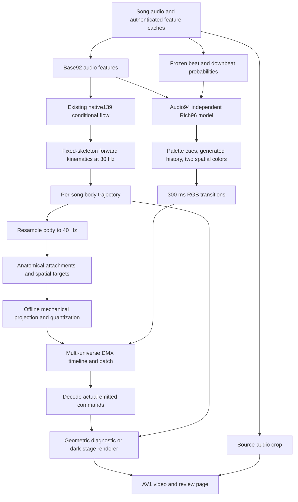
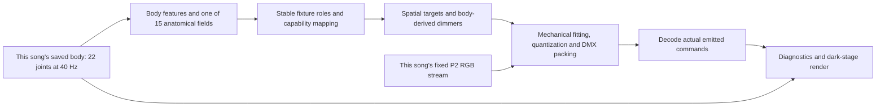
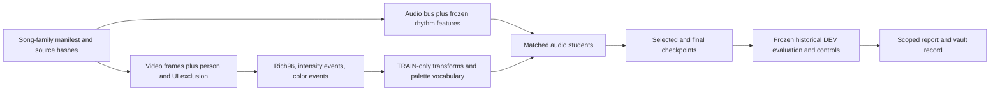

# LightSem architecture

Reviewed against the working tree on **2026-10-02**. Git HEAD at review was
`1a407d4`; the working tree also contained the newer P2 decision, body-transfer
implementation, tests, and delivery records. This document describes those
working-tree files, not just the last commit. Historical measurements below are
attributed to their saved reports; this documentation review did not rerun the
experiments or qualify a model.

LightSem is a research and engineering project for turning music into stage
lighting. It contains audio analysis, learned color and motion models, body-to-light
mapping, fixture constraints, DMX encoding, stage visualization, and a substantial
experiment archive. The current development path combines an existing
audio-conditioned body generator with a separately learned color layer. Its output
is an authenticated lighting timeline that can be inspected and rendered.

The repository is a Python package plus campaign scripts, rather than one unified
service or application. Several older pipelines remain executable for research
reproduction. Their presence does not make them current product defaults.

## Contents

- [1. Current decisions and status](#1-current-decisions-and-status)
- [2. Repository and storage map](#2-repository-and-storage-map)
- [3. Current end-to-end pipeline](#3-current-end-to-end-pipeline)
- [4. Audio and time contracts](#4-audio-and-time-contracts)
- [5. The learned color layer](#5-the-learned-color-layer)
- [6. Body generation and transfer](#6-body-generation-and-transfer)
- [7. DMX, rendering, and transport](#7-dmx-rendering-and-transport)
- [8. Data and training architecture](#8-data-and-training-architecture)
- [9. Other model generations](#9-other-model-generations)
- [10. Evaluation and evidence](#10-evaluation-and-evidence)
- [11. Runtime and entry points](#11-runtime-and-entry-points)
- [12. Brief project evolution](#12-brief-project-evolution)
- [13. Key concepts](#13-key-concepts)
- [14. Papers and research foundations](#14-papers-and-research-foundations)
- [15. Extension points and outstanding limits](#15-extension-points-and-outstanding-limits)

## 1. Current decisions and status

The controlling project requirements are in [AGENTS.md](AGENTS.md). Read these
alongside [the baseline configuration](configs/light_layers/baseline.json) and
[the body-transfer campaign](experiments/2026-09-30-body-transfer/README.md).

| Component | Current decision | Scope of acceptance |
| --- | --- | --- |
| Color model | Independent Rich96, recipe `I_VR_P0`, seed 0, selected checkpoint | User-selected color baseline; not a newly confirmed scientific winner |
| Color policy | **P2**: generated palette history, 300 ms causal smoothstep RGB transitions, two spatial color groups | First chromatic palette component on the left, second on the right |
| Body source | Existing audio-conditioned native-motion flow | The demonstrated body is accepted as the source for transfer work |
| Motion mapping | Body-to-N-output adapter | V1 implemented and demonstrated; choreography is not yet approved |
| Demo inputs | Shpongle **and** AURORA — Cure For Me | Each song must have its own body trajectory; body remains visible in diagnostics |
| Motion substitutions | Autonomous oscillators, beat sweeps, random motion, and canned time-driven choreography are rejected | A failed transfer must be diagnosed rather than concealed by another motion source |

P2's reference video contains historical rhythm-companion motion. That video
selects **color only**. It does not authorize that motion for future demos.
Baseline C and the September 12 rhythm-companion authorization are historical.
The configuration intentionally still says there is no approved N-output mapper:
an implemented, audited prototype and an approved lighting result are different
states.

The selected color checkpoint is pinned by path and SHA-256 in the configuration:

```text
/mnt/lightsem-data/experiments/lightsem/lighting-cue-model-20260922t094347z/
  observer_fits_v1/04_seed0_I_VR_P0/best.pt
SHA-256: 8de865906cfabb49290971eccf6016ab38edebe885eec7e6369f020fb5544b8a
```

The V1 transfer demonstration uses 8 moving beams, 5 simulated laser rays, and
50 bulbs. Its recorded audits report distinct moving trajectories and successful
stationary-body controls. Its review also reports central beam overlap and poor
gesture readability. Cure For Me's color is nearly static: one RGB transition
in the reviewed 120 seconds, versus 44 for Shpongle. These are engineering
observations, not proof of artistic quality or cross-song generalization. See
[the campaign report](experiments/2026-09-30-body-transfer/README.md) and
[generation audit](experiments/2026-09-30-body-transfer/records/GENERATION_PRIMARY_AUDIT_V1.json).

Some older READMEs and module docstrings still say “baseline C,” “what ships,”
or “no dancer at inference.” Interpret those within their historical pipeline.
They do not override the current requirements.

## 2. Repository and storage map

```text
lightsem/
├── audio/                  Audio features, beat grids, structure, anticipation
├── data/                   AIST++, Oslo, media ingestion, remote RPMC access
├── motion/                 COCO-17 skeletons and legacy motion descriptors
├── model/
│   ├── light_layers/       Current color-model family and its training tools
│   ├── light_trunk.py     Earlier A/B/C Conformer
│   ├── infer.py           Earlier descriptor-model inference API
│   ├── encoder.py         RPMC macro encoder
│   └── group_decoder.py   Historical role/effect decoder
├── conductor/              Descriptor conductors and current body_transfer.py
├── dmx/                    Canonical fixtures, encode/decode, scene engine
├── sim/                    Headless volumetric stage renderers and GLSL
├── festival/               Blender venue, canonical-DMX fanout, Art-Net
├── eval/                   Light features, beat alignment, FID, blind A/B
├── experiments/            Executable research implementations by family
└── cli.py                 Original analysis/rule-scene CLI

scripts/                   Launchers, extraction, training, diagnostics, rendering
configs/                   Selected baseline and festival fixture configuration
experiments/<campaign>/
├── records/               Protocols, reports, receipts, source snapshots
└── outputs/               Preserved repository-local experiment deliveries
docs/                      Technical notes and older plans/research
tests/                     Focused unit, integration, and failure-control tests
assets/                    Local scene/support assets
data/                      Local corpus/cache paths; bulk data ignored by Git
ingest/                    Historical ingestion helpers
runs/                      New transient outputs; ignored by Git
run.sh                     CPU/audio/render environment wrapper
run_torch.sh               Dedicated Torch environment wrapper
```

Two different `experiments` directories serve different purposes:
`lightsem/experiments/` is importable source code; root `experiments/` is the
research and delivery archive. Start with the [campaign index](experiments/README.md)
and [script index](scripts/README.md), rather than executing an arbitrary dated
script found in an archived output directory.

| Storage boundary | Responsibility |
| --- | --- |
| Git working tree | Source, tests, configuration, compact protocols and evidence |
| `/mnt/lightsem-data/` | Large datasets, feature caches, weights, and frozen experiment artifacts |
| `/root/lightsem/runs/` | Transient generation/render directories, review pages, downloaded research assets |
| `/root/lightsem-vault/` | Project scientific memory: problems, hypotheses, predictions, experiments, rule-outs, and interpretations |
| `/root/vibescience-vault/` | Unrelated project; never a LightSem write destination |

Media, most array payloads, and weights are excluded by [.gitignore](.gitignore).
A checkout alone is therefore insufficient to reproduce a delivery. A complete
reproduction needs its external artifacts, environment, and frozen manifest.

The September 29 reorganization is recorded in
[RELOCATION_MAP.json](experiments/RELOCATION_MAP.json). Old absolute paths in
frozen reports are documentary. Rebinding an old run to relocated source requires
a new versioned binding; historical receipts should not be silently rewritten.

## 3. Current end-to-end pipeline



The important module boundaries are:

1. **Audio to representation.** Body and color are separate learned branches,
   with different feature rates and checkpoint contracts.
2. **Body to desired lighting.** The transfer adapter maps supplied poses into
   spatial targets and brightness. It has no audio or independent choreography
   clock input.
3. **Desired lighting to emitted lighting.** Mechanical fitting and integer DMX
   encoding may alter trajectories. They must be inspected independently of raw
   body targets.
4. **Emitted lighting to pixels.** The renderer consumes decoded commands.
   Optical visibility is a separate issue from whether angles change numerically.
5. **Outputs to evidence.** Manifests and audits bind the model, source song,
   timeline, renderer, video, and soundtrack to the claimed result.

The current orchestration is
[run_body_transfer_demo.py](scripts/motion/run_body_transfer_demo.py), with
separate `generate` and `render` stages and an explicit JSON plan. It is a
campaign-specific artifact pipeline, not a general arbitrary-song inference API.
For the saved V1 run:

- Shpongle uses the exact accepted body's prefix from its original full-song
  inference. Its P2 RGB comes from the pinned reference stream.
- Cure For Me receives a fresh body from the same historical flow model, with
  draw seed 7001. Its P2 color is reconstructed from saved predictions generated
  on Cure For Me and the frozen palette transforms.
- Both compute a 180-second prefix and review seconds 60–180, preserving the
  first minute's context/history. A cropped presentation is not a fresh start of
  the stateful computation.

The color-loading helper reads historical canonical streams for RGB only. It
does not take their companion motion as the new movement source. The render
stage reuses an old media-audit helper; that import likewise does not activate
the rhythm-companion controller.

## 4. Audio and time contracts

[audio/online.py](lightsem/audio/online.py) defines `AudioBus`: timestamps,
feature channels, mel features, beats, downbeats, tempo, duration, flags, and
metadata. The main bus analyzes 44.1 kHz audio with a 1024-sample hop and maps
the resulting approximately 43.07 Hz analysis grid to the 40 Hz control grid.

`Base92` is 64 log-mel bins plus the 28 ordered scalars in
[AUDIO_SCALARS](lightsem/model/light_data.py): energy, flux, onset, spectral
shape, percussiveness, pulse clarity, and beat/bar features. Band-specific flux
preserves distinctions between bass and high-frequency percussion.

`Audio94` appends beat and downbeat probabilities derived from frozen Beat This
logits. [SourceStore](lightsem/model/light_layers/training.py) interpolates the
saved 50 Hz rhythmic outputs onto the audio-bus clock before normalization. The
word “logits” in source-cache descriptions does not mean raw logits are passed
unchanged into the 94-dimensional student.

| Representation | Shape / rate | Contract |
| --- | --- | --- |
| Audio bus mel | `(64, T40)` | Scalars share `AudioBus.times` |
| Descriptor/body-model audio | `(T, 92)` | Native body generation interpolates to 30 Hz |
| Light-layer input | `(B, T40, 94)` | `T40` divisible by four |
| Light-layer slow context | `(B, T40/4, D)` | Four-frame mean pooling, 10 Hz |
| Native motion features | `(T30, 139)` | Root velocity/height, rotations, contacts |
| Body joints | `(T30, 22, 3)` | Y-up, meters, canonical articulated skeleton |
| Transfer body | `(T40, 22, 3)` | Linear interpolation at physical timestamps |
| Canonical legacy DMX | `(T40, 512)`, `uint8` | One universe, canonical rig |
| Body-transfer DMX | `(T40, U, 512)`, `uint8` | Separate patch list defines virtual fixtures |
| Current review video | 1920 × 1080, 30 fps | Presentation samples the saved lighting timeline |

**Causality is a property of the complete path.** Non-beat bus features have a
causal mode, including trailing smoothing and sample-and-hold resampling. The
five constant-grid beat/bar features are marked `oracle_beat`: they use a
whole-track beat estimate. Light-layer attention is offline and symmetric, the
current body model uses future context, and the angular optimizer fits whole
trajectories. Therefore the current P2/body-transfer pipeline is offline, even
though its RGB fades are causal.

[beatgrid.py](lightsem/audio/beatgrid.py) fits constant tempo by comb search;
[rhythm_clock.py](lightsem/audio/rhythm_clock.py) adds an offline local tracker.
These are analysis tools. Their existence does not authorize a beat clock to
generate the current lamp motion.

The original [features.py](lightsem/audio/features.py),
[structure.py](lightsem/audio/structure.py), and
[anticipation.py](lightsem/audio/anticipation.py) form another analysis branch:
beats/onsets, recurrence-based section boundaries, section labels, tension, and
causal/oracle drop-timing estimates. That older feature path uses its own grid;
do not join arrays by index merely because they belong to the same song.

## 5. The learned color layer

### 5.1 Architecture and outputs

[model/light_layers/model.py](lightsem/model/light_layers/model.py) defines
`LightLayersConfig`, `AudioEncoder`, `SharedLightLayers`, and
`IndependentLightLayers`. P2 uses the independent architecture: **three actual
audio encoders**, not one shared encoder with three output heads.

| Branch | Input/context | Output |
| --- | --- | --- |
| Accent | 10 Hz context repeated to 40 Hz, concatenated with original Audio94 | Accent logit at 40 Hz |
| Chromatic change | Own 10 Hz encoder | Color-change logit at 10 Hz |
| Palette | Own 10 Hz encoder plus previous generated palette embedding | 32 palette logits when requested |

The campaign uses three Conformer blocks, four attention heads, convolution
kernel 15, and attention window 160 at 10 Hz. Independent width 76 is matched
against shared width 128 by trainable parameter count, within the prescribed
5% tolerance. This matches parameter budget, not FLOPs or measured latency.
The recorded Rich96 configurations have approximately 1.284M and 1.242M
parameters respectively.

The configured slow-context radius is 258 frames on either side (25.8 seconds
at 10 Hz), plus the alignment implied by four-frame pooling. Default input
length is capped at 12,000 control frames. Longer inputs fail; this API does not
silently supply a tested full-song chunking implementation. Attention-mask
allocation is still quadratic in sequence length.

The model's `forward()` returns logits and palette context, not DMX. The caller
owns thresholding, cue extraction, palette rollout, state/history, and rendering.
Palette ID 32 is the learned null-history state, not a 33rd output color class.
Inference history consists of generated previous IDs, never future target labels.

### 5.2 What Rich96 and P0 mean

[targets.py](lightsem/model/light_layers/targets.py) constructs a 96-dimensional
visual target from retained background pixels:

- 72 bins: 12 circular hue bins × 6 saturation bins, with bilinear deposition.
- 24 summaries: six measurements for each of four image quadrants (hue cosine,
  hue sine, mean saturation, hue concentration, chromatic fraction, retained
  mask fraction).

Chromatic statistics require saturation at least 0.12 and HSV value at least
0.08. HSV-value summaries for intensity are kept separately. Missing color
support has an explicit validity mask; a black observation is not automatically
a valid chromatic observation or a segmentation failure.

`I_VR_P0` means independent encoders, Rich96 visual auxiliary supervision, and
no pose auxiliary in this color model. **P0 does not mean there is no body in
the complete lighting pipeline.** The visual auxiliary attaches to the chromatic
branch and is returned during training; video is not a playback input.

### 5.3 From source video to color supervision

[visual.py](lightsem/model/light_layers/visual.py) decodes synchronized source
frames, uses cached person/pose boxes to prompt stateless per-frame SAM2, excludes
people and UI, and records retained-background statistics. YOLO/SAM2 are target
construction instruments, not deployed audio-to-color encoders.

Chromatic changes use distances between local hue/saturation distributions,
eligibility checks, and separated event times. Training fits normalization,
event thresholds, and a 32-token palette vocabulary on TRAIN data. The target is
an authored-video observer proxy: camera cuts, masking mistakes, and game graphics
can contaminate it. It is not direct access to a lighting engineer's DMX.

### 5.4 P2 decoding and composition

Generated history conditions palette selection at fixed color cues. The selected
configuration uses argmax decoding, retains the palette between cues, and fades
to adopted RGB targets over 0.3 seconds. A cue may reselect the same palette;
therefore **cue count, token changes, and RGB changes are separate quantities**.

[transitions.py](lightsem/model/light_layers/transitions.py) implements causal
channel-RGB fades. Its values are DMX proportions, not calibrated radiance.
[visual_next/palettes.py](lightsem/experiments/visual_next/palettes.py) derives
representative chromatic components from palette prototypes;
[visual_next/delivery.py](lightsem/experiments/visual_next/delivery.py) applies
the spatial layout. P2 assigns two components spatially, without inventing new
temporal motion or learning an independent palette for every fixture.

[overlay.py](lightsem/model/light_layers/overlay.py) is the older composition
boundary for adding supplied accents/colors to a saved canonical DMX stream.
Its allowlist preserves protected slots exactly. RGB-only canonical comparisons
change 33 RGB slots and protect the other 479; comparisons that also enable
accent/dimmer edits have a different allowlist. The current body-transfer path
uses P2 RGB but computes its own body-derived dimmers and motion.

## 6. Body generation and transfer

### 6.1 Existing audio-conditioned body generator

The active demonstration reuses
[motion_study/music_model.py](lightsem/experiments/motion_study/music_model.py).
`MusicModel` supports regression and conditional-flow arms; the accepted body
source uses the flow arm. Its default width is 256, with eight residual dilated
convolution blocks and 32 Euler integration steps. Audio conditioning has 92
channels; the generated motion state has 139.

The flow learns a vector field between a temporally correlated noise field and
normalized target motion. Training combines native-feature MSE with a 0.05-weighted,
TRAIN-scaled derivative-error term. The inference sampler creates one global
noise field and updates one full-sequence state at every step. Chunked field
evaluation uses the full receptive-field halo; it does not independently restart
noise or integrate root motion in each chunk.

The native representation is defined in
[native_codec.py](lightsem/experiments/motion_study/native_codec.py) and
[geometry.py](lightsem/experiments/motion_study/geometry.py):

```text
139 values/frame at 30 Hz
  3    root horizontal velocity vx/vz and root height
132    22 local rotations × 6D rotation representation
  4    ankle/toe contact probabilities
```

`NativeCodec` is an uncompressed reference, not a learned bottleneck. It clamps
contact probabilities but does not reconstruct missing rotations from a hidden
source pose. Fixed-skeleton forward kinematics produces `(T,22,3)` joints;
horizontal root velocity is integrated once over the recording. The rotation
convention stores the first two **rows** of the rotation matrix, matching the
local FineDance conversion. A generic 6D rotation implementation with another
convention is not interchangeable without conversion.

In provenance, `prior_native_flow` means the **previous audio-conditioned model**.
It does not mean an unconditional generator. The accepted saved Shpongle body was
generated with Shpongle audio. See the
[origin correction and audit](experiments/2026-09-30-cross-song/records/USER_REVIEW_AND_MOTION_LINEAGE.md).
Current transfer work does not require retraining or requalifying that dancer
before improving its mapping to light.

### 6.2 Anatomical transfer to arbitrary output counts

[conductor/body_transfer.py](lightsem/conductor/body_transfer.py) exposes:

| API | Responsibility |
| --- | --- |
| `build_outputs(beams, lasers, bulbs)` | Fixed fixture positions, capabilities, anatomical attachments, and strip coordinates |
| `source_weights(chain, fraction)` | Nonnegative normalized interpolation weights on an articulated limb chain |
| `sample_body(world, source_fps, target_fps)` | Resampling at physical timestamps, without tempo retiming |
| `raw_transfer(body, outputs, config)` | Desired spatial targets, body-derived dimmers, and source-point diagnostics |
| `constrained_transfer(body, outputs, left_rgb, right_rgb, config)` | Mechanically feasible quantized commands and multi-universe patch |
| `decode(dmx, patch)` | Actual angles, directions, RGB, and dimmers consumed by the preview |

Moving outputs cycle through left arm, left leg, right leg, and right arm chains.
Additional fixtures sample different positions along those chains and use fixed
spatial transforms. Horizontal root drift is removed for the local installation;
height, orientation, and articulation remain. Body points map to a bounded
continuous floor/back-wall target chart. Local point speed drives dimmer level.

Fixed bulbs use a different capability mapping: hand and foot positions create
four spatial intensity fields along the garland, modulated by limb speed. The
bulbs do not aim, and their pattern does not run from a chase clock. Constants
such as spatial shear, field width, and fixture placement are mapping choices,
not learned dance information.

Counts are configurable, with a code validation range of 0–10,000 per kind and
at least one output required. This is not a demonstrated performance guarantee
at that scale. Adding fixtures yields related manifestations of source gestures,
not an equal number of independent dance sources. Changing counts may also
change chain sample positions; stable anatomical meaning matters more than
assuming fixture index is invariant across every configuration.

### 6.3 Mechanical projection and final commands

The adapter converts world target vectors to pan/tilt and calls
[offline_angles.project_angles](lightsem/experiments/motion_study/offline_angles.py).
This is a whole-trajectory convex fit using Clarabel and sparse SciPy matrices.
It minimizes angular target error subject to position, speed, and acceleration
bounds. An inscribed polygon conservatively bounds the two-dimensional derivative
norms, and the constraints reserve rounding error before 16-bit quantization.

Default transfer limits are 90°/s and 360°/s², with 540° pan and 270° tilt ranges.
The optimizer verifies the emitted integer trajectory. A constant desired target
has a direct exact quantization path to avoid solver tolerance creating a moving
DMX tick. This preserves the stationary-body control when RGB is also held fixed.
If externally supplied RGB varies, a frozen body can still change color; the
invariant concerns autonomous motion, and full-byte constancy requires constant
color inputs too.

This projection is **offline**, not a causal servo implementation. Constraint
fitting can change timing and attenuate gestures; a low target error alone does
not establish that a viewer can read the gesture.

### 6.4 Fifteen-method transfer portfolio (October 4)

The experimental [transfer portfolio](experiments/2026-10-04-body-transfer/README.md)
separates anatomical representation, fixture capability mapping, and mechanical
compilation. `body_transfer_v2.map_body(body, outputs, algorithm_id, fps=40)`
selects one of fifteen deterministic, paper-inspired fields. Every field exposes
22 anatomical samples, source attribution, fixed parameters, and limitations.
`make_outputs` provides stable fixture IDs and roles when outputs are appended;
the default physical 8-beam/5-ray/50-bulb placement matches V1. Additional outputs
sample related source gestures; they do not create more independent dance
information. The module name remains `body_transfer_v2`; the current frozen
execution and evidence are revision V3.



The capability adapter maps those fields to desired spatial targets and body-derived
intensity, including a spatial field on the garland. It consumes no independent
animation clock. `body_transfer.compile_intent` then applies the shared angular
limits, quantization and DMX patching. V1's `constrained_transfer` remains a wrapper
around its original `raw_transfer` and this compiler, preserving the original
entry point. The new algorithms are experimental candidates, not an approved
replacement for the current lighting result.

V3 repairs two losses introduced by the capability mapping. Method 03 now passes
its absolute expanded FK skeleton through one shared translation, fixed rotation
and uniform body-dependent bounding scale. Separate fixture offsets no longer
destroy the intended skeletal relationships. Method 08 solves instantaneous
source-proximity graph consensus and maps its wrist/torso/head group through one
shared transform; the garland uses the same structure. Structural attribution
includes every source joint that can influence the shared scale. Neither
transformation adds an independent temporal driver.

The campaign reuses each song's own authenticated 180-second saved body and its
exact P2 RGB. It compares seconds 60–180 for Shpongle and Cure For Me. Source
snapshots, before/after diagnostics, frozen-body and six-region sensitivity
checks, raw-target duplicate checks, and media provenance are mandatory. All 30
V3 timelines are independently verified, including the 90°/s and 360°/s² emitted
simulation limits. Fourteen methods pass the unchanged crossing-reduction gate
on both songs. Corrected 03 preserves desired FK shape but increases projected
ray crossing to 0.779/0.783 from V1's 0.582/0.569, and is a negative diagnostic.
Corrected 08 reaches 0.251/0.249 and passes; emitted contact errors and
brightness-weighted crossings remain separate limitations. Preserving targets
does not guarantee that boundary hits or visible beams preserve their shape.

Most methods retain shared fixture anchors and spatial bases. Methods 10/11
have strongly similar motion; algorithm count is not visual-discovery count.
Brightness has separate limitations: 03 leaves 11 Shpongle / 12 Cure edge bulbs
at the same dim floor in the review crop, including duplicate same-side bulb
commands. In 08, seven moving outputs have fixed dimmers while their directions
still vary. These are separate from the moving-angle stream checks.
V3 has a new ancillary timing report using exactly the V2 measurement method and
a new input freeze. Corrected 03/08 retain body-to-emitted direction recurrence
of 0.917/0.920 and 0.916/0.907 (Shpongle/Cure), while their velocity recurrence
and high-frequency amplitude show remaining loss. Shift/reversal controls reduce
recurrence and constant-output controls are undefined. This temporal evidence
does not override 03's failed crossing gate. V3 also recomputes the same-protocol
cross-method similarity: 10/11 remain strongly similar, while repaired 03/08 have
changed waveform relationships. Low or negative signed similarity does not prove
better choreography. Both original V2 ancillary reports remain historical.
P2 color is exact across revisions: Cure still has one RGB transition and a 112.4-second
constant-color interval in the review crop. See the
[V3 numerical results and evidence boundaries](experiments/2026-10-04-body-transfer/RESULTS_NUMERIC.md).

The renderer consumes decoded emitted commands and offers a CPU schematic path;
the dark-stage path requires coordinated exclusive GPU access. The renderer's
16-moving/128-bulb bound remains separate from numerical arbitrary-N support.
All 30 V3 dark-stage videos are delivered with verified source bindings, full
software decode, uniform timestamps, matching audio crops and HTTP download
identity. The [review page](http://127.0.0.1:8773/?campaign=v3-complete) compares
each 120-second 1080p30 candidate with its historical baseline. V2 artifacts remain
under `/mnt/lightsem-data/experiments/lightsem/body_transfer_20261004_v2`; current
V3 artifacts use the separate `_v3` root. These are offline engineering results,
with artistic acceptance and physical fixture deployment still unqualified.

## 7. DMX, rendering, and transport

### 7.1 Two fixture schemas

The canonical legacy rig in [conductor/rig.py](lightsem/conductor/rig.py) and
[dmx/fixtures.py](lightsem/dmx/fixtures.py) has 14 fixtures: six moving heads,
four washes, two blinders, one strobe, and one projector. Its role abstraction
groups broad functions such as beam, big/slow, fast, event, and back lighting.
[encode.py](lightsem/dmx/encode.py) packs parameters into a 512-slot universe;
[decode.py](lightsem/dmx/decode.py) reconstructs fixture controls for metrics and
rendering. Sixteen-bit pan/tilt must be decoded as a value, not analyzed as
independent coarse/fine byte changes.

The body-transfer adapter uses a separate compact virtual personality:

| Output kind | Slots | Layout |
| --- | ---: | --- |
| Beam or simulated laser | 8 | Pan coarse/fine, tilt coarse/fine, dimmer, R, G, B |
| Bulb | 4 | Dimmer, R, G, B |

Its default 63 outputs occupy 304 slots. Fixtures are allocated whole into
successive universes; no fixture crosses a 512-slot boundary. The patch records
one-based channel addresses and zero-based universe IDs. The serialized patch
is essential: the same byte positions have different meanings in the canonical
and body-transfer schemas.

### 7.2 Renderers

| Renderer | Purpose and input | Limits / interpretation |
| --- | --- | --- |
| [sim/renderer.py](lightsem/sim/renderer.py) + [shaders.py](lightsem/sim/shaders.py) | Original canonical-rig volumetric stage, ModernGL/EGL and GLSL raymarching | Fixed diagnostic scene and optical approximation |
| [render_body_transfer.py](scripts/rendering/render_body_transfer.py) | Geometric body/beam/bulb transfer diagnostic from saved timeline and patch | Source body visible; makes attachments and trajectories inspectable |
| [sim/body_stage_renderer.py](lightsem/sim/body_stage_renderer.py) + [render_body_dark_stage.py](scripts/rendering/render_body_dark_stage.py) | Dark volumetric stage using decoded body-transfer commands | At most **16 moving outputs and 128 bulbs** in this backend |
| [festival/blender_scene.py](lightsem/festival/blender_scene.py) | Historical editable Eevee venue | Legacy preview backend |
| [festival/realistic_scene.py](lightsem/festival/realistic_scene.py) | Dark Cycles venue with passive geometry, haze, textured projectors | Optional photorealistic previsualization, not manufacturer-calibrated photometry |

The body-stage renderer inherits the old dark scene's optical vocabulary but
adds emissive bulb points and analytic thin-ray integration for lasers. Shader
time is fixed; changing directions, levels, and colors come from DMX. The
analytic laser treatment avoids flicker from sparse volumetric sampling.
Its fixture cap is a rendering limit, not the adapter's output-count limit.

The body diagnostic and dark-stage delivery read the same `timeline.npz` and
`patch.json`; they are two views of the same commands. The current timeline
stores `universes`, `time`, resampled `body`, raw `targets`, `source_points`,
and `bulb_field_centers`. This supports investigation at both sides of the
mechanical projection without using the unprojected targets as emitted light.

### 7.3 Festival fanout and live Art-Net

[festival/patch.py](lightsem/festival/patch.py) is an independent adapter for
expanding **canonical** DMX to an installation. It records each fixture's source
slots, destination address, position, target, and optical parameters, then copies
the specified source bytes into new universes. This fanout duplicates existing
controller decisions; it does not implement body-transfer anatomical sampling.
The body-transfer patch list is not a drop-in festival binding.

The documented photographic venue has 24 moving heads, 12 washes, four projectors,
four virtual lasers, and 12 garland circuits representing 960 modeled bulbs.
Its historical C-based source binding is preserved; it is not an approved new
P2 body-transfer motion demo. See [FESTIVAL_SCENE.md](docs/FESTIVAL_SCENE.md) for
its complete reproduction and rendering contract.

[festival/artnet.py](lightsem/festival/artnet.py) implements explicit-peer
ArtDmx UDP transport. [router.py](lightsem/festival/router.py) receives canonical
universe 0 and expands it through a venue patch;
[blender_live.py](lightsem/festival/blender_live.py) updates Blender objects from
received universes. The receiver validates packets/sequences and blacks out stale
universes (documented default: two seconds). Broadcast discovery, multi-console
merging, and ArtSync are not implemented.

Transport capability does not make offline inference real-time. DMX also does
not carry soundtrack time: offline rendering binds audio and DMX to source
timestamps, while frame-exact live media synchronization needs a separate
transport/timecode mechanism. Laser profiles here describe simulated rays, not
an ILDA or physical scanner driver.

## 8. Data and training architecture

### 8.1 Corpora have different roles

| Source | Local integration | What it supports and what it does not establish |
| --- | --- | --- |
| AIST++ / AIST Dance DB | [data/aist.py](lightsem/data/aist.py), COCO-17 motion descriptors | Legacy dance supervision and geometry diagnostics; local audits found genre/choreography confounds, so paired data alone does not establish audio dependence |
| Oslo club-dancing data | [data/oslo.py](lightsem/data/oslo.py), [oslo_audio.py](lightsem/data/oslo_audio.py) | Free-dancing dynamics and structure experiments; reconstructed stimulus audio must preserve the recorded clock |
| Just Dance videos | `scripts/data/build_justdance_*`, [model/jd_data.py](lightsem/model/jd_data.py), visual extraction | Coach motion and authored-background observations; multiple coaches/crops are not independent songs |
| RPMC-L2 | [data/rpmc_remote.py](lightsem/data/rpmc_remote.py), [model/data.py](lightsem/model/data.py), extraction scripts | Concert-video lighting statistics and audio; image histograms are not fixture-level DMX labels |
| FineDance | `lightsem/experiments/motion_study/{download,prepare,geometry}.py` | Native articulated-motion representation and music-to-body studies |
| Beat Saber / authored shows | `scripts/data/{pull_beatsaver,build_beatsaver}.py` | Historical authored event/control investigations; game semantics require their own transfer argument |
| User songs | Frozen campaign audio paths and provenance receipts | Product demonstrations and input-sensitivity checks; exposed examples are not sealed test data |

[DATA_NOTES.md](docs/DATA_NOTES.md) records the measured AIST inventory of 1,408
real keypoint sequences and 60 audio tracks. Archive metadata had previously
doubled the apparent file count. Optimized keypoints and raw keypoints have
different NaN behavior, and pose clips can be much shorter than their associated
audio. The loader's sequence duration, not the audio duration, bounds paired
analysis. [data/sync.py](lightsem/data/sync.py) preserves a refuted per-track
offset method; its presence is not a recommendation to apply those offsets.

RPMC's OpenL3 features have a true 10 Hz information rate even when cached on
a 30 fps light grid. The legacy model loader decimates interpolated audio and
aggregates lighting to 10 Hz. Upsampling never creates extra temporal evidence.
Corpus and media permissions are separate from the licenses of model code;
research provenance is retained with each campaign.

### 8.2 Light-layer training



[training.py](lightsem/model/light_layers/training.py) owns immutable source
references, source loading, transforms, batch sampling, loss computation,
checkpointing, and fit-budget checks. September 22 fits used 91 TRAIN and 31
historical DEV groups after nine TRAIN identity quarantines, five recipes and
three seeds. The fixed schedule was 6,000 AdamW updates, batch size four,
learning rate 0.0003, BF16 mixed precision with FP32 losses, 64-second feature
windows, and central eight-second supervision.

Main loss combines accent BCE, chromatic-event BCE, and palette cross-entropy.
Enabled auxiliary losses have weight 0.1. Palette state dropout is 0.5; rollout
and generated-history handling are explicit rather than hidden mutable state
inside the network. Checkpoint selection uses historical DEV main loss.
Feature caches and beat analysis may have whole-record support, so a 64-second
student input is not a claim of 64 seconds of raw-audio access or causal context.

### 8.3 Visual-next experiments

[lightsem/experiments/visual_next/](lightsem/experiments/visual_next/) contains
four related research interventions:

- **H1:** TransNet V2 cut/transition detection to exclude editing events.
- **H2:** Cutie mask propagation from fixed anchors versus stateless SAM2.
- **H3:** Explicit spatial color, frozen DINOv2 features, and temporal differences
  as auxiliary targets, with random-encoder, shuffled, and reversed controls.
- **H4:** Fixture-color oracles to test how much the output representation can
  express when privileged reference information is supplied.

The explicit spatial grid is 4 × 4 cells × 75 values = 1,200 features. Frozen
DINOv2-S/14 patch features are pooled into corresponding cells. Temporal arms
combine current features with differences to prior observations; projections
and normalizers are fit on TRAIN. These are offline target/observer experiments,
not the accepted P2 inference architecture.

The archive records 24 fits, 27 checkpoint evaluations, and 19 review entries.
Completion of that execution is separate from confirmation: independent source
labels remain unmeasured, the representation-retention gate failed, and the
fixture-oracle gain missed its magnitude target. See
[RESULTS_EXPLORATORY.md](experiments/2026-09-29-visual-next/records/RESULTS_EXPLORATORY.md).

## 9. Other model generations

These implementations explain the project's design choices and support old
results. Their checkpoints and input schemas are not interchangeable.

| Family | Main code | Architectural idea / present role |
| --- | --- | --- |
| Original structure-to-scene prototype | `audio/{features,structure,anticipation}.py`, `dmx/scenes.py`, `cli.py` | Rule-mapped sections with a deterministic effects layer; historical prototype |
| RPMC macro model | `model/{data,encoder}.py` | Patched causal Transformer over 512D OpenL3, predicts six scene statistics and future horizons |
| Descriptor A/B/C model | `model/{light_trunk,light_data,jd_data,infer}.py` | Conformer predicts deterministic envelopes, event hazards, and sampled residual style; separate legacy `LightModel` API |
| Group-effects model | `model/group_decoder.py` | Role-level controls and a deterministic effect engine; Stage 9/10 investigations |
| Stage 11 | `experiments/stage11/` under the package | Matched pointwise versus temporal scene flow, controlled conditioning/evaluation, human-rating and delivery infrastructure |
| No-clock dance pilot | `experiments/dance_no_clock/` under the package | Music-only spectral conditioning to continuous dance controls, without beat-clock features |
| Beat-conditioned pilot | `experiments/beat_conditioned/` under the package | Restored Base92 input, supervised A/B and joint temporal C flow, fixed geometry and emitted-motion controls |
| Overnight campaign | `experiments/night/` under the package | Audio-feature/conditioning comparisons, MuQ and other feature probes, expressive rig and reconstruction diagnostics |
| Motion representation studies | `experiments/motion_study/` under the package | Native/learned codecs, music-to-motion, articulated mappings, pose/surface/optics/actuator studies; contains the reused current body generator |
| Rhythm companion | `audio/rhythm_clock.py`, `experiments/motion_study/companion.py` | Audio-led procedural timing with saved-body spatial style; retained for provenance, superseded as a future motion policy |

The original descriptor boundary is `MotionDescriptors` in
[motion/descriptors.py](lightsem/motion/descriptors.py), obtained either from
real motion or predicted by a model. The A/B/C split separates deterministic
regression, event hazards, and conditional sampling. The measured v2 split keeps
six predictable A channels and moves the other continuous targets into C.

`ConductorV0` is the strict motion-only comparison; `ConductorHybrid` combines
motion envelopes with audio-phase transients; `beat_trigger.py` is a simple rule
baseline. These are distinct experimental conditions, not synonyms for the new
22-joint transfer adapter.

The causal legacy trunk composes its attention and convolution history across
layers: `n_blocks * (attn_window - 1 + conv_kernel - 1) + 1`. Defaults imply
1,039 frames, about 26 seconds at 40 Hz, not one four-second attention window.
That historical chunking lesson still matters, but it does not turn the current
offline color/body models into a causal system.

## 10. Evaluation and evidence

### 10.1 Separate the failure modes

[output_diagnostics.py](lightsem/experiments/output_diagnostics.py) provides
finite-value, motion, palette, representation-activity, and cross-input checks.
Its `motion_activity()` currently expects **six canonical heads**; arbitrary-N
body-transfer runs use their own decoded-output audits. A generic-sounding module
name is not a guarantee of arbitrary-rig support.

| Observation | What must be checked separately |
| --- | --- |
| No color cues | Inactive event head; not by itself proof that the representation collapsed |
| Many cues, one palette | Palette selection/occupancy collapse despite event activity |
| Varying colors, identical angles | Color dependence without demonstrated motion dependence |
| Large angle changes, dark or overlapping rays | Numeric motion without readable emitted gestures |
| Different output hashes | Byte differences; not automatically new choreography |
| Constant control channel | Intentional fixed control versus failed learned output |
| Many fixture outputs | Anatomical diversity versus exact duplication of existing streams |

Before a large render batch, inspect finite values, motion ranges and speed,
inactive time, saturation, cue counts, actual palette changes and occupancy,
and exact duplicate streams. Distinguish body information loss from mapper loss
and from loss after mechanical constraints and quantization.

For source dependence, freeze the body, perturb an assigned limb, and change
fixture counts while checking gesture timing in the actual emitted output.
For music dependence, use at least two songs with weights, noise/seed, mappings,
and rendering settings held fixed; recompute each audio-dependent branch.
Compare after beat/tempo alignment and include distinct music with similar BPM.
Inspect phrases, holds, repeated motifs, and visible gestures. A replaced
soundtrack over reused motion is not a new music-conditioned generation.

### 10.2 Metrics need controls and a declared unit

The older [eval/](lightsem/eval/) package supplies light-onset alignment with a
metronome ceiling and circular-shift null, delta-based light features, Frechet
distance with split-half references, diversity, block shuffles, and randomized
A/B material matched for brightness. Level-only statistics can reward a static look;
beat alignment alone can reward a metronome.

Light-layer [metrics.py](lightsem/model/light_layers/metrics.py),
[evaluation.py](lightsem/model/light_layers/evaluation.py), and
[palette_metrics.py](lightsem/model/light_layers/palette_metrics.py) add
event AP, song-level aggregation, paired bootstrap intervals, multiplicity
adjustment, donor/shift controls, and distinct palette instruments. The visual
proxy event tolerance is ±0.2 seconds; it is not the separate 70 ms rhythm-label
instrument. Source coverage and qualified-null coverage are eligibility gates,
not details to discard after observing a favorable score.

Independent units are recordings/songs or canonical song families, as defined
by the campaign. Frames, crops, coaches, camera views, and random seeds cannot
silently substitute for independent songs. Fit transformations on TRAIN only;
previously exposed DEV or TEST data cannot be relabeled fresh confirmation.

### 10.3 Findings that constrain the current interpretation

| Evidence | Recorded result and architectural implication |
| --- | --- |
| [September 22 observer study](experiments/2026-09-22-color-beat/records/OBSERVER_RESULTS_V1.md) | Rich-minus-legacy color AP delta −0.01493, interval includes zero; qualified null support 29 versus 30 required. Rich96 is not a statistically established universal improvement. |
| [Palette-history study](experiments/2026-09-22-color-beat/records/PALETTE_SECONDARY_RESULTS_V1.md) | Shared-model selected-checkpoint temporal error 0.859022 versus 0.830589 for independent cue-held choices, 3.42% worse. This scoped result does not negate the later personal selection of P2. |
| [Visual-next results](experiments/2026-09-29-visual-next/records/RESULTS_EXPLORATORY.md) | R3 retention failed; downstream AP gain was about 0.000607 versus a 0.03 target; H4 image error improved 0.847% versus a 20% target. Execution completed, qualification failed. |
| Same visual-next delivery | Eight new models emitted zero color cues and identical DMX outputs. Their varying inherited colors were not evidence that the new learned color heads activated. |
| [September 30 user review](experiments/2026-09-30-cross-song/records/USER_REVIEW_AND_MOTION_LINEAGE.md) | R1's two palette changes, P4 flicker, and cross-song motion sameness were rejected. P2/P4 share moving-head RGB and non-RGB commands; only auxiliary colors differ. |
| [Cross-song diagnostic](experiments/2026-09-30-cross-song/README.md) | Similar-BPM songs exposed palette sticking and shared procedural motion vocabulary. The old test reused a Shpongle-generated body, so it tested the companion path, not fresh per-song body generation. |
| [Body-transfer V1](experiments/2026-09-30-body-transfer/README.md) | Per-song bodies and source-dependent outputs delivered; gesture readability and Cure For Me color remain unresolved. |

Historical verdicts stay attached to their original targets, controls, and
baseline. A relevant old hypothesis needs a new evaluation against P2/current
motion; product selection does not retroactively change scientific results.

### 10.4 Artifact and scientific-memory contracts

Campaigns bind input paths and hashes, source/feature clocks, code, checkpoint,
normalizers, random state, thresholds, and output locations. Generation and
delivery are separate stages so a failed output can be diagnosed before a large
render. Completed output directories are immutable; a revision uses a new plan
and destination. Check each campaign's resume contract: light-layer fits reject
silent overwrite/resume, whereas some older training runners save resumable RNG.

Media audits decode the entire video, inspect frame count and timestamps, and
compare decoded audio with an independently encoded crop of the correct source.
Review pages support timestamp-preserving comparisons and seekable media. These
checks establish delivery integrity; they do not constitute a blinded preference
study.

[scripts/vault/log_to_vault.py](scripts/vault/log_to_vault.py) provides a stdio
MCP client with `VIBESCIENCE_VAULT=/root/lightsem-vault` pinned.
[VIBESCIENCE_API_NOTES.md](docs/VIBESCIENCE_API_NOTES.md) documents the validated
API contract. Project memory writes are authorized, but must preserve historical
evidence and leave the unrelated default vault unchanged. The recorded writer
defect can drop custom headings in Notes; compare full records and use the
documented preservation/recovery procedure when updating affected records.

## 11. Runtime and entry points

### 11.1 Environments and dependencies

The repository is environment-bound: it has no root `pyproject.toml`, dependency
lock, or complete requirements manifest. Root wrappers set the working directory
and `PYTHONPATH`; many campaigns also pin absolute paths. Historical setup
scripts are not a complete installer for the current system.

| Runtime | Main dependencies / responsibilities |
| --- | --- |
| CPU/audio environment via `run.sh` | NumPy, SciPy, librosa, scikit-learn, pandas, audio/video readers; ModernGL/EGL where needed |
| Dedicated Torch environment via `run_torch.sh` | PyTorch/CUDA, neural training/inference, model-specific extraction dependencies; Clarabel for current angular fitting |
| Media tools | `ffmpeg`, `ffprobe`; NVIDIA AV1 encoding for recorded compact deliveries |
| Optional Blender environment | Isolated Blender executable, Cycles/OptiX or legacy Eevee; separate from ordinary Python imports |
| Scientific memory | External Vibescience MCP installation and project vault |

`run_torch.sh` defaults to `/mnt/lightsem-data/venv-torch` and fails if its Python
is unavailable. `TORCH_ENV` can select another dedicated environment; the script
index and current transfer plan record `/root/lightsem/.venv/torch-access` for
this host. That is a saved configuration, not a guarantee that a mount or GPU is
currently available. Follow the project guidance to use wrappers and `uv` for
environment management, rather than system pip or another project's venv.

### 11.2 Useful navigation commands

Run from the repository root. These are interface/navigation examples, not a
claim that historical artifacts have been regenerated by this review:

```bash
# Inspect the current two-stage body-transfer entry point.
bash run_torch.sh scripts/motion/run_body_transfer_demo.py --help

# Inspect color training/evaluation interfaces before preparing a new binding.
bash run_torch.sh scripts/light_layers/run_light_layers_train.py --help
bash run_torch.sh scripts/light_layers/run_light_layers_evaluate.py --help

# Source-only focused checks, in an environment with their dependencies.
bash run_torch.sh -m pytest tests/test_body_transfer.py -q
bash run_torch.sh -m unittest discover -s tests -p 'test_light_layers_model.py'
bash run.sh -m pytest tests/test_output_diagnostics.py -q
bash run.sh -m unittest discover -s tests -p 'test_festival_dmx.py'

# Earlier pipeline invariants; this is not an omnibus current-product release gate.
bash run_torch.sh scripts/diagnostics/verify_all.py

# Serve an existing current review, if its saved run is present.
python3 scripts/rendering/serve_light_review.py \
  --root /root/lightsem/runs/body_transfer_20260930_v1/review --port 8771
```

For exact generation commands, use the transfer campaign's
[QUEUE_V1.json](experiments/2026-09-30-body-transfer/records/QUEUE_V1.json) and
[PLAN_V1.json](experiments/2026-09-30-body-transfer/records/PLAN_V1.json). The
existing plan targets a completed immutable directory; a new execution needs a
new output binding and authenticated inputs. Changing a copied plan's path alone
does not authenticate changed source code.

Test families cover model shapes/state, feature and target semantics, temporal
support, training contracts, metric nulls, protected DMX slots, body perturbations,
quantized constraints, renderer observability, festival routing, and media
provenance. GPU/data-dependent campaign gates are distinct from fast unit tests.

The older `python -m lightsem.cli render` uses the original structure/scene path.
Likewise `scripts/rendering/render_song_demo.py` loads the descriptor/hybrid
generation. Neither is the current P2 body-transfer entry point, and
`lightsem.model.infer.LightModel` cannot load an independent Rich96 checkpoint.

## 12. Brief project evolution

Dates below follow the records' experiment dates; Git commits sometimes preserve
several earlier activities together. Commit messages document contemporary
interpretations and must be read alongside later audits and user decisions.

| Period | Change in direction | What remains relevant |
| --- | --- | --- |
| August 2026 / initial September 4 commits | Audio structure and anticipation, RPMC statistics, rule-driven club rig, DMX and headless rendering | Established audio/fixture/render separation and exposed invalid corpus assumptions; [archived plan](docs/archive/PLAN.md), [data notes](docs/DATA_NOTES.md) |
| September 3–4 | Dance-trained audio-to-descriptor pipeline; AIST/Oslo audits; causal Conformer A/B/C split | Predictability must be measured per target; genre, gain, phase, and causality confounds cannot be solved by model size alone |
| September 4 | Offline pivot, spectral calibration, Just Dance extraction and held-out-song experiments | Stronger source diversity and new supervision; old claims retain their tested metrics and later qualifications |
| September 4–5, Stages 9/10 | Authored-light targets, role/effect decoder, stems/embeddings, scene planner/critic, cue-held sampling | Explored direct light supervision and state, but did not establish all proposed conditioning or product benefits |
| September 8–10 | Stage 11, no-clock and beat-conditioned pilots, overnight feature/conditioning campaign | Separated output statistics from visible choreography; [overnight report](experiments/2026-09-10-night/records/RESULTS.md) reports no new configuration passing both-seed acceptance |
| September 10–12 | Representation-first motion studies: native rotations, codecs, audio-conditioned bodies, surface/pose/actuator/optics diagnostics | Produced the body generator and geometry/constraint infrastructure reused today; [motion research](experiments/2026-09-10-motion/records/RESEARCH.md) |
| September 12 | Rhythm companion authorized: audio-controlled phrase timing, saved motion as spatial style | Delivered active lighting but later rejected as the motion policy for body transfer; retained evidence is not erased |
| September 22–29 | Audio-only accent/color/palette layers with Rich96 supervision; observer and history studies | Modular color learning and protected-slot overlays; scientific benefit gates remained unqualified or failed |
| September 29 | User selects independent variant 06, then history plus 300 ms fades as C; repository reorganized; Blender festival added | Separate model selection, rendering infrastructure, and file relocation; no scientific promotion from the reorganization itself |
| September 29–30 | Visual-next cut, mask, representation, and fixture-color studies; 19-entry Shpongle review | Diagnostic outputs exposed inactive color heads, duplicated streams, and representation/capacity limits |
| September 30 | Cross-song review rejects shared motion vocabulary and sparse/stuck colors; user selects P2 color layout and requires literal body transfer | Current requirements supersede C/rhythm-companion defaults; source-dependent N-output adapter becomes active work |
| September 30 working-tree additions | Two-song 8-beam/5-ray/50-bulb transfer and dark-stage views delivered from saved commands | Technical delivery exists; spatial gesture readability, cross-song color quality, and product acceptance remain open |

Useful Git landmarks: `1656ffd` (dance-trained v2), `36ed994` (Stage 11 and
beat-conditioned checkpoint), `3f2f448` (motion representation work), `01a14fe`
(pose/timing/render diagnostics), `d1084a8` (reorganization), `ff342ff` (historical
C), `2eff936` (festival scene), `dcd8537` (visual studies), and `1a407d4`
(cross-song diagnostics). The newer uncommitted files described here are not
implicitly contained in those hashes.

## 13. Key concepts

| Term | Meaning in this project |
| --- | --- |
| Conductor / mapper | Converts representation-level signals into fixture controls; its policy is distinct from a learned model |
| Macro / micro | Historical separation between slower section/look decisions and faster events/effects; not permission to add autonomous motion now |
| A / B / C targets | Predictable continuous envelopes / event hazards / sampled residual style in the descriptor-model family |
| Conditional-mean collapse | Regression averages ambiguous target behavior into weak or static controls; sampling can retain diversity but does not prove audio dependence |
| Conditional flow | Learned vector-field generation conditioned on audio; distinguish ODE integration time from musical playback time |
| Native139 | Explicit root, local rotation, and contact representation, with no learned compression |
| Forward kinematics | Converts local joint rotations and root motion into an articulated world-space body using fixed bones |
| Rich96 | A defined chromatic observation/auxiliary target, not a 96D image encoder injected at playback |
| Cue versus palette | An opportunity to choose versus the actual chosen color state; repeated selection can leave color unchanged |
| Palette history | Previous generated token supplied to the palette head; null history is an explicit learned state |
| P2 | Current two-group color policy around the selected independent Rich96 checkpoint; not a new body model |
| Observer proxy | A measurable video-derived target whose error and nuisance variables must be qualified |
| Oracle | An evaluation condition with privileged information, such as reference colors or future beats; capability evidence differs from deployable prediction |
| Fanout | Replication/repatching of existing controller bytes; increases fixture count without increasing independent learned decisions |
| Body transfer | Capability-aware spatial mapping of actual body gestures, with traceable anatomical source points |
| Emitted output | Commands after mechanics and DMX quantization, rather than unconstrained model or mapper targets |
| Null / negative control | Deliberately uninformative, shifted, donor, frozen, or otherwise broken condition used to test what a metric detects |
| Magnitude gate | Required practical effect size, distinct from statistical significance |
| Product gate | User-visible usefulness or preference, distinct from source validity and automated metric performance |
| Frozen binding | Versioned configuration and hashes identifying the exact inputs, implementation, random state, and artifacts for a run |

## 14. Papers and research foundations

This is an architecture-oriented reading map, not an exhaustive literature review
or a claim that every cited model is deployed. Primary publication/project pages
for the core references below were checked during this documentation review.
The implementation/status column is grounded in local code and campaign records;
it is LightSem's use or interpretation of the work, not a result claimed by the
paper about LightSem.

### 14.1 Learning and motion foundations

| Reference | Idea relevant to the design | LightSem connection |
| --- | --- | --- |
| Gulati et al., 2020, [Conformer: Convolution-augmented Transformer for Speech Recognition](https://arxiv.org/abs/2005.08100) | Combines attention with convolutional temporal processing | Locally implemented Conformer-style blocks in `light_trunk.py`, reused in offline light-layer encoders; not a pretrained speech checkpoint |
| Lipman et al., 2023, [Flow Matching for Generative Modeling](https://arxiv.org/abs/2210.02747) | Learns generative vector fields along conditional probability paths | Mathematical background for flow-based generation; local objectives, conditioning, and solvers must be assessed separately |
| Liu, Gong, and Liu, 2022/2023, [Flow Straight and Fast: Learning to Generate and Transfer Data with Rectified Flow](https://arxiv.org/abs/2209.03003) | Noise-to-data transport through learned ODE dynamics | Background for sampled style and native-motion flows; does not itself prove musical control |
| Li et al., ICCV 2021, [AI Choreographer: Music Conditioned 3D Dance Generation with AIST++](https://arxiv.org/abs/2101.08779) | Music-conditioned dance generation and reconstructed dance data | AIST++ source and baseline context; local genre/choreography confounds limit LightSem claims |
| Li et al., ICCV 2023, [FineDance: A Fine-grained Choreography Dataset for 3D Full Body Dance Generation](https://github.com/li-ronghui/FineDance) | Paired music and detailed articulated dance; official dataset/code release | Native motion source for representation and body-model studies; local conversion uses 22 body joints |
| Tseng, Castellon, and Liu, CVPR 2023, [EDGE: Editable Dance Generation From Music](https://arxiv.org/abs/2211.10658) | Music-conditioned articulated dance generation with physical considerations | Motion-design reference; the local fixed skeleton cites EDGE's released visualization geometry. The current generator is LightSem's `MusicModel`, not an EDGE checkpoint |
| Zhou et al., CVPR 2019, [On the Continuity of Rotation Representations in Neural Networks](https://arxiv.org/abs/1812.07035) | Continuous higher-dimensional rotation representations | Basis for local 6D rotation storage and orthonormalization; row/column conventions still require round-trip checks |
| Li et al., CVPR 2024, [Lodge: A Coarse to Fine Diffusion Network for Long Dance Generation Guided by the Characteristic Dance Primitives](https://arxiv.org/abs/2403.10518) | Long-duration dance with global/local organization | Continuity and native-representation research reference, not the deployed body model |

### 14.2 Lighting, musical movement, and audio features

| Reference | Idea relevant to the design | LightSem connection |
| --- | --- | --- |
| Zhao et al., [Automatic Stage Lighting Control: Is it a Rule-Driven Process or Generative Task?](https://arxiv.org/abs/2506.01482), v2 2025, and [RPMC-L2](https://huggingface.co/datasets/RS2002/RPMC-L2) | Skip-BART learns lighting statistics from recorded performances | Direct stage-lighting prior art and corpus provenance; LightSem's local six-vector is not identical to the paper's prediction target |
| Burger et al., 2013, [Influences of Rhythm- and Timbre-Related Musical Features on Characteristics of Music-Induced Movement](https://www.frontiersin.org/journals/psychology/articles/10.3389/fpsyg.2013.00183/full) | Relates musical features to different movement characteristics | Motivates separate frequency-band flux and body-region descriptors. Population correlations do not establish precise frame-level choreography prediction |
| Palmer et al., 2013, [Music–color associations are mediated by emotion](https://pmc.ncbi.nlm.nih.gov/articles/PMC3670360/) | Studies perceptual music/color associations | Supports considering more than hue alone; not a framewise lighting label source or a fixed music-to-palette lookup table |
| Foscarin et al., 2024, [Beat this! Accurate beat tracking without DBN postprocessing](https://arxiv.org/abs/2407.21658) | Learned beat/downbeat estimation | Frozen rhythmic probabilities augment Base92 to Audio94; rhythmic features are conditioning inputs, not permission for autonomous lamp choreography |
| Kim and Nam, 2023, [All-In-One Metrical And Functional Structure Analysis With Neighborhood Attentions on Demixed Audio](https://arxiv.org/abs/2307.16425) | Joint metrical and functional structure analysis | Reviewed structure/rhythm alternative; not the default current tracker merely because it appears in the research notes |
| Zhu et al., 2025, [MuQ: Self-Supervised Music Representation Learning with Mel Residual Vector Quantization](https://arxiv.org/abs/2501.01108) | Self-supervised music representations | Frozen layer extraction in the overnight campaign; not an input dependency of the accepted Base92/Audio94 paths |

### 14.3 Visual observation and supervision

| Reference | Idea relevant to the design | LightSem connection |
| --- | --- | --- |
| Ravi et al., 2024, [SAM 2: Segment Anything in Images and Videos](https://arxiv.org/abs/2408.00714) | Promptable image/video segmentation | Stateless frame segmentation for Rich96 background extraction; mask quality and color-target quality are separate endpoints |
| Souček and Lokoč, 2020, [TransNet V2: An effective deep network architecture for fast shot transition detection](https://arxiv.org/abs/2008.04838) | Shot-transition detection | H1 separates likely video edits from candidate lighting/color events |
| Cheng et al., CVPR 2024, [Putting the Object Back into Video Object Segmentation](https://arxiv.org/abs/2310.12982) | Cutie uses object-level memory for mask propagation | H2 temporal person exclusion from fixed anchors; smooth masks alone do not establish correct retained backgrounds |
| Oquab et al., 2023/2024, [DINOv2: Learning Robust Visual Features without Supervision](https://arxiv.org/abs/2304.07193) | Frozen transferable visual features | H3 patch-feature auxiliaries and controls; the local retention pipeline failed qualification, which does not isolate the cause to DINOv2 itself |

Additional papers and alternatives—including DINOv3, VideoPrism, V-JEPA,
VideoMAE, RAFT, perceptual metrics, segmentation controls, motion codecs, and
world-motion recovery—are cataloged with their actual reading scope and source
identities in the existing dossiers:

- [Motion representation research](experiments/2026-09-10-motion/records/RESEARCH.md).
- [Visual-target primary-source dossier](experiments/2026-09-22-color-beat/records/lightsem_campaign_visual_papers.md).
- [Rhythm primary-source notes](experiments/2026-09-22-color-beat/records/lightsem_campaign_rhythm_read_notes.md).
- [Visual-next paper notes](experiments/2026-09-29-visual-next/records/PAPER_NOTES.md)
  and [paper identity/hash inventory](experiments/2026-09-29-visual-next/records/PAPERS.json).
- [Festival implementation references](docs/festival-research.md) and
  [photographic-rendering research](docs/festival-photoreal-research.md).

The older [prior-art review](docs/archive/RESEARCH.md) is useful historical
context. Its broad claims that a field, dataset category, or technique “does not
exist” are dated search conclusions, not maintained architectural facts.

## 15. Extension points and outstanding limits

The following are boundaries exposed by the current implementation, not a newly
approved experimental program:

| Work area | Natural extension boundary | Required evidence |
| --- | --- | --- |
| Gesture readability | `body_transfer.py` spatial transforms, attachment policy, installation geometry | Same per-song bodies; limb/source sensitivity; less overlap and visible phrase/gesture retention after constraints |
| Another output capability | Output description, capability-specific transfer, matching encoder/decoder and renderer | Exact channel contract, stationary-source behavior, multi-universe round trip |
| Cross-song color improvement | Light-layer targets/model, cue and palette policies | P2-controlled comparison; separate cue inactivity, palette occupancy, and output color; required two-song review |
| Larger dark-stage installations | Renderer array/uniform design or another rendering backend | Visibility of every intended output and unchanged command semantics; adapter scaling alone is insufficient |
| Unified application API | Composition of current body/color generation, plan validation, mapping, and delivery | New-song recomputation and provenance without dependence on one frozen demonstration's paths |
| Streaming deployment | Audio tracker, model context, stateful generation, causal actuator controller | Measured latency and future-perturbation tests across the entire path; current offline projection cannot be relabeled streaming |
| Festival integration of body transfer | Explicit conversion or shared fixture-schema abstraction | Preserve virtual-fixture semantics and anatomical controls; do not silently reinterpret canonical slots |
| Model or research claim | Versioned protocol, independent support, null/magnitude/product gates | Preserve failed results and exposure history; no promotion from an attractive single-track rendering |

There are also concrete maintenance constraints. The reusable body adapter
currently imports angular conversion and optimization from experimental modules;
its conceptual layer boundary is cleaner than its Python dependency boundary.
Paths and environments are hard-coded in several campaigns, pretrained assets
live outside Git, and there is no single dependency lock or universal launcher.
Some old documentation retains superseded defaults. Refactoring these seams
would require new authenticated bindings before claiming reproduction of frozen
runs.

For any change, keep the scientific result, emitted command behavior, and user
acceptance separate. Preserve the source body, identify which branch actually
depends on each song, and inspect constrained DMX plus rendered light before
calling an implementation an improvement.
