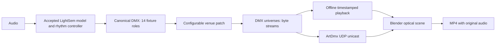

# LightSem festival scene

The festival is an editable Blender scene, connected to LightSem through actual
DMX bytes. The accepted baseline C remains the controller. A separate venue patch
routes its 14 source fixtures into a configurable installation; changing the
scene does not require retraining the model or modifying the diagnostic renderer.

The current default is the empty, completely moonless **photographic** revision.
It contains 24 moving heads, 12 washes, four actual textured projector lights,
four virtual laser scanners, and 12 RGB garland circuits (960 modeled bulbs).
There are no people. Neutral tensile canvas, braided metallic portals, stitched
fabric sculptures, stage hardware, and irregular damp ground replace the flat
materials and luminous outlines of the first preview. Cycles traces shadows,
reflections, indirect illumination and haze. The world and every passive material
have zero emission: with the controls off, the rendered image is exactly black.

The old Eevee preview is available explicitly with `--style legacy`; it is no
longer the default. The selected LightSem model and DMX controls are unchanged.
The new optical installation redirects the washes onto the passive portal and
canopy surfaces, with physical stands at their patched positions.

## Connection



There is no fixture-count constant in the bridge or receiver. The allocator spills
whole fixture personalities into further universes, each containing 512 slots.
The practical limits are memory, rendering hardware and Art-Net's 15-bit address
space. Universe numbers below are **zero based**; channel addresses are **one
based**. Some lighting applications display universe 0 as “Universe 1”.

| Default output | Port address | Slots | Source roles |
| --- | ---: | ---: | --- |
| Original controller, unchanged | 0 | 1–512 | Canonical rig |
| 24 moving heads, 12 slots each | 1 | 1–288 | mh1–mh6, repeated |
| 12 washes, 7 slots each | 1 | 289–372 | wash1–wash4, repeated |
| Four media projectors, 10 slots each | 1 | 373–412 | proj1, repeated |
| Four virtual lasers, 12 slots each | 1 | 413–460 | mh1–mh4 |
| 12 garland circuits, 4 slots each | 1 | 461–508 | wash1–wash4, repeated |

Each JSON fixture records its name, source fixture, original channel indices,
destination universe/address, personality, position, target and optical ranges.
All output bytes are traceable to the original controller. Pan and tilt retain
their 16-bit precision. The garlands have separate dimmer/RGB channels and separate
physical routes between the patched `position` and `target`.

More fixtures currently mean **deterministic expansion of existing decisions**.
They do not mean that the model has learned 56 independent lighting intentions.
The patch and transport are the stable extension points for future independent
output heads, group choreography, media-server inputs, or new fixture profiles.

## Reproduce or expand

Blender 4.5 LTS and ffmpeg are sufficient for rendering. This host has an isolated,
checksum-verified Blender at `/opt/blender-lightsem/blender`; no desktop session,
Blender MCP, addon, or system Python audio/ML installation is required. Override
the executable with `LIGHTSEM_BLENDER=/path/to/blender`. CPU export uses the
existing LightSem `run.sh` environment and NumPy.

Export the accepted baseline into a new immutable binding directory:

```bash
bash run.sh -m lightsem.festival.patch --output-dir runs/my_festival/binding
```

Render a native 1080p AV1/AAC clip and bake an editable animation. The default
`photographic` backend needs Cycles OptiX; this host's RTX 5070 is verified. A
32-sample full-HD frame takes about five seconds here, so test a still first:

```bash
bash scripts/festival/run.sh \
  --binding runs/my_festival/binding --output runs/my_festival/show \
  --start 118 --duration 12 --fps 24 --samples 32 --bake
bash run.sh scripts/festival/audit_festival.py \
  runs/my_festival/show/lightsem_festival_render.json --binding runs/my_festival/binding
```

Use `--start 0 --duration 277.3` for the entire available track. Source timestamps
are preserved, and an out-of-range render fails rather than padding the end. The
binding contains the complete track regardless of the rendered excerpt. A still
can be made with `--still 120 --shot floor` or `--still 140 --shot wide`; use a
different `--name` for each output. `--build-only` saves the scene without rendering.
`--blackout --still 120` creates a control-off comparison with identical geometry.
MP4 output refuses to overwrite an existing delivery. Use a new output directory
for revisions. A still/build saves the current look; `--bake` on a movie is required
for native animated playback after reopening without Python autoexecution. Baked
exports pack the soundtrack into the `.blend` and use compressed native storage.

For the exact delivered installation, copy its fixture positions, targets and
explicit `photographic_flux_watts` using an immutable re-export:

```bash
bash run.sh -m lightsem.festival.patch --output-dir runs/my_dark_festival/binding \
  --patch configs/festival/dark.json
bash scripts/festival/run.sh --binding runs/my_dark_festival/binding \
  --output runs/my_dark_festival/still --still 120 --shot floor --samples 128
```

To render your edits in an existing `.blend` without rebuilding its geometry, use
the saved-scene renderer. Both photographic render commands default to 6 Mbps
AV1. The legacy initial-render command retains the compact 1.1 Mbps review preset.
The saved-scene renderer preserves the file's engine and supports both Cycles
and Eevee.

```bash
/opt/blender-lightsem/blender --background --disable-autoexec \
  runs/my_festival/show/lightsem_festival.blend --threads 8 --python-exit-code 1 \
  --python scripts/festival/render_saved_scene.py -- \
  --output runs/my_festival/show/lightsem_festival_hq.mp4
bash run.sh scripts/festival/audit_festival.py \
  runs/my_festival/show/lightsem_festival_hq_render.json --binding runs/my_festival/binding
```

The high-quality rerender uses the saved native animation, camera and scene edits.
The source audio and binding remain authenticated. Its bitrate is configurable
with `--bitrate` and `--maxrate`. The compact video remains useful for quick review.

Scale fixture counts freely, with automatic repatching:

```bash
bash run.sh -m lightsem.festival.patch \
  --output-dir runs/larger_festival/binding \
  --moving-head-count 130 --wash-count 30 --projector-count 8 \
  --laser-count 12 --garland-count 36
```

Alternatively export with `--repeat 3 --repeat-step 40 0 0`, or edit a copy of
`fixture_patch.json` and export it with `--patch your_patch.json`. Fixture repeats
translate their positions and targets; the architectural canopy/stage remains
the sample venue, so a multi-stage venue also needs geometry/camera changes.
Do not edit an authenticated binding in place: re-export it. The loader checks
the saved bytes, all derived controls, and the fixture source mapping for equality.

To change audio, first run the accepted LightSem inference pipeline and bind the
new audio/DMX together. This renderer consumes real controller output and does not
replace inference with an amplitude-reactive animation.

## Live Art-Net

Open the delivered `.blend`, pause its timeline, select the text block
**Connect Art-Net · run manually**, and run it in Blender's Text Editor. This
recovers the existing objects and starts a nonblocking main-thread receiver at
`127.0.0.1:6454`. No rebuild is required. Start playback in a shell:

```bash
bash run.sh -m lightsem.festival.artnet runs/my_festival/binding \
  --host 127.0.0.1 --start 108 --duration 36
```

The saved text keeps its returned `receiver`; call `receiver.stop()` in that
script's context to release the port. The receiver automatically stops before
loading a new Blender file. It rejects malformed packets and old sequence
numbers, holds the latest valid universe, and blacks out fixtures on stale
universes after two seconds. The timeout is configurable.

For another machine, explicitly change the receiver's `bind` to its interface
address (or `0.0.0.0`) and the sender's `--host` to that machine. This is explicit
peer unicast with no broadcast, discovery or ArtPoll management.

For fresh inference through the existing LightSem Art-Net sender, start the live
router and set that sender's destination to `127.0.0.2:6454`:

```bash
bash run.sh -m lightsem.festival.router \
  --patch runs/my_festival/binding/fixture_patch.json
```

The router receives canonical universe 0 at `127.0.0.2:6454` and sends the
expanded venue universes to Blender at `127.0.0.1:6454`. Those are two distinct
loopback addresses, avoiding a port conflict or echo loop on one machine. Use
`--bind`, `--port`, `--host` and `--output-port` for a different topology. There is
one source controller; multi-console merging and ArtSync are not implemented.
Malformed, out-of-order and unrelated-universe packets are ignored. Silence
produces no synthetic frames, letting the receiver's timeout work normally.

For an in-process integration, call `fanout_dmx(source_frame[None], patch)[0]` on
each canonical frame and send the rows with `patch['universe_ids']` through
`ArtNetSender.send_frame`. The model and Blender process remain separate.

DMX does not carry audio or media playback time. The offline video samples DMX
and trims audio from the same source timestamp. Live media shaders use the local
receiver clock; frame-exact live audio/media sync requires an additional timecode
or transport layer. Offline synchronization is verified in the media audit.

## Rendering model and limits

Moving heads use shadow-casting Blender spots and a bounded, nonuniform haze
volume. Their power is
approximately normalized by cone solid angle so narrowing the zoom does not
silently discard nearly all beam power. The soft edge, arbitrary wattage defaults,
camera exposure and sRGB-to-linear mapping make this a previsualization, not a
manufacturer-calibrated photometric measurement. Zoom, motion, dimmer, RGB and
shutter use decoded DMX. Focus and moving-head/laser gobos are not optically modeled.

In the photographic backend, the four projectors are actual Cycles spot lights.
Their shader uses light-local perspective coordinates and a rectangular mask;
its procedural image is projected onto passive matte fabric. Portals, cables and
stage structures cast real shadows into it, and the projected light reflects onto
other surfaces. DMX controls power, tint, aim, zoom and pattern. The authored media
palette and playback clock are content, not extra learned LightSem outputs.
Projector wattage includes an artistic compensation for the low average duty of
the line-art media; it is not a calibrated commercial lumen specification.

The legacy Eevee backend still uses an emissive receiver approximation because
Eevee does not support textured spot-light node trees. Laser profiles in both
backends control visible ray geometry, not an ILDA/scanner hardware driver. The
photographic rays are submillimetre geometry with no diffuse-reflection contribution.

These generic personalities are intentionally independent of fixture brands.
Physical equipment needs its actual personality/GDTF and installation limits.
The preserved diagnostic renderer and selected baseline have not been replaced.

## Verification

```bash
bash run.sh -m unittest tests.test_festival_dmx tests.test_festival_router -v
```

The tests cover universe expansion, overlaps, exact source bytes, 16-bit motion,
causal sampling, packet layout, malformed packets, sequencing/timeouts, and an
actual saved-file → UDP → identical-controls round trip. Media auditing performs a
full software decode, checks frame count, resolution and uniform timestamps, and
compares the decoded soundtrack against the original at the declared offset.
Research and official source links are in [festival-research.md](festival-research.md).

The dark-scene validator independently checks missing people, zero world/passive
emission, fixture recovery, and input hashes. It can also apply a zero-dimmer
state in memory and verify that a previously rendered blackout PNG is exactly
black. It never renders or modifies the saved scene:

```bash
/opt/blender-lightsem/blender --background --disable-autoexec \
  runs/my_dark_festival/still/lightsem_festival.blend --python-exit-code 1 \
  --python scripts/festival/verify_dark_scene.py -- --blackout \
  --report runs/my_dark_festival/dark_validation.json
```

Implementation evidence for the Cycles GPU, true projected shadows, and optical
choices is in [festival-photoreal-research.md](festival-photoreal-research.md).

For a baked photographic movie, `scripts/festival/verify_dark_animation.py`
reopens five timeline positions and compares the native light/material/laser
properties against DMX application at those exact source timestamps. It also
authenticates the packed audio bytes and source-frame offset. Run it like the
dark-scene validator with a loaded `.blend` and `--report PATH.json`; it performs
no GPU rendering and never saves over the scene.
