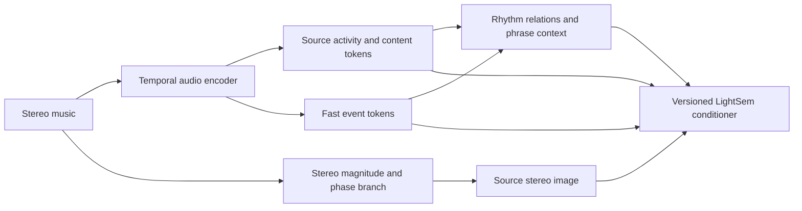

# LightSem: learning what is happening in the music
Research review — 4 October 2026. Literature and code audit; no model was trained, benchmarked, or promoted.

A separate music-understanding stage is a well-founded direction to investigate. The strongest research question is whether a representation can preserve **which source is active, what it plays, its timing relative to other events, and its stereo image**, and whether LightSem can use that information. The literature offers several implementable routes; it does not yet identify a winner for LightSem.

The recommended first comparison is **dense pretrained encoders versus supervised source/event distillation versus source-aware self-supervised learning**, with a stereo branch shared or independently ablated. Do not build every component into one model before establishing what each contributes.

The user's clarification governs this review: historical “ruled out” entries are evidence about the actual experiment. They are not a blacklist of method families. A revisit should name what changed and preserve the original results.

## What the current project actually has

- Base92 uses mono 44.1 kHz input, 64 log-mels and 28 scalar channels, delivered at 40 Hz. It represents spectral bands and beat features, not explicit instruments. Stereo information is discarded by the loader. [Frontend](/root/lightsem/lightsem/audio/online.py:184).
- P2's color branches consume Audio94: Base92 plus Beat This beat/downbeat probabilities. Their context is pooled to 10 Hz; accents also receive 40 Hz input. **Rich96 describes a visual training target.** [Audio assembly](/root/lightsem/lightsem/model/light_layers/training.py:485), [encoder](/root/lightsem/lightsem/model/light_layers/model.py:113).
- Existing HTDemucs extraction starts with stereo but saves four stems as mono 22.05 kHz. It therefore cannot test source-specific stereo representation. There are 332 whole-track and 90 trailing-window caches. [Extractor](/root/lightsem/scripts/data/extract_stems.py:31).
- The accepted body path is a separate audio-conditioned native flow, using Base92 at 30 Hz and 139 motion channels. Its acceptance as the body source stands. The proposed audio research does not require reopening body reconstruction. [Generation](/root/lightsem/scripts/motion/run_body_transfer_demo.py:102).
- P2 remains the accepted color policy: independent checkpoint, palette history, 300 ms transitions, two spatial color groups. New audio features require a versioned model arm because existing checkpoint input contracts differ. [Pinned baseline](/root/lightsem/configs/light_layers/baseline.json).
- Available hardware is one RTX 5070 with approximately 12 GB VRAM. Existing MERT/MuQ weights and caches make baseline extraction economical; no paper-scale training runtime has been measured here.

Vibescience recall and causal-map inspection recovered these relevant experiments:

| Prior experiment | Actual evidence | What remains open |
|---|---|---|
| H-G / exp-018 source stems | Primary full-stem ridge AP gain +0.0185, CI [0.0150, 0.0219], below the committed +0.02 gate; neural arm did not improve its incumbent. A separate rhythm-hazard variant recorded +0.0238; it does not replace the primary comparison. | Different source representation, stereo retention, better targets, newer separators, and source-aware objectives. This was not “stems contain no useful information.” |
| H-M / exp-019 frozen MERT | Roughly +0.019 AP, +0.018 after song-mean subtraction, with strong song-identity retrieval. | Whether local information survives suitable readout/adaptation. Song identity can coexist with useful temporal content. |
| exp-night-muq-20260909 | Conditional energy score worsened 0.63418445 → 0.63934897; centered-donor controls did not establish the intended local benefit. | Source/instrument/rhythm supervision, other layers/objectives, and newer models. This does not establish universal representation collapse. |
| Current body transfer | Each song has its own body; emitted transfer tests exist. Cure For Me has only one RGB transition in the examined 120 s, versus 44 for Shpongle. | Color inactivity, musical understanding and motion quality are distinct questions. P2 layout acceptance does not qualify all songs. |

Sources: [stem experiment](/root/lightsem-vault/experiments/exp-018-source-separated-stems-add-e2c503.md), [MERT experiment](/root/lightsem-vault/experiments/exp-019-one-frozen-music-foundation-d4f30f.md), [MuQ experiment](/root/lightsem-vault/experiments/exp-night-muq-20260909.md), [transfer record](/root/lightsem/experiments/2026-09-30-body-transfer/README.md:82). Earlier scopes and verdicts are preserved.

## Broad method map

| Family | Useful role | Main question before choosing it |
|---|---|---|
| DSP, HPSS, NMF, pan/delay clustering | Cheap source/rhythm/spatial baselines and inspectable targets | Is a learned model better than explicit signal features on the intended task? |
| Fixed-stem separation: Demucs, BSRNN, BS/Mel-band RoFormer | Offline waveform teachers; source images and events | Do cleaner waveforms improve activity/timing/spatial labels, and where do stems leak? |
| Query separation: Banquet, QSCNet, AudioSep, SAM Audio | Finer instruments, unusual sounds, semantic prompts | Can the model distinguish an absent source from a weak extraction? |
| Dense foundations: MERT, MuQ, MusicFM, BEATs, CLAP internals, Audio-JEPA, MERT2 | Frozen features, adapters, or student teachers | Which temporal/layer information is useful under a matched readout? |
| Stem SSL: MSCOL, COCOLA, Stem-JEPA | Learn compatibility, shared rhythm/harmony and source relationships | Does compatibility learning retain local source-specific facts? |
| Factorized/object representations: DisMix, source codecs | Separate identity/content and expose manipulable latent factors | Does factorization generalize beyond the training mixture/domain? |
| AMT and drum transcription | Note/onset/offset/instrument/velocity supervision | Are labels reliable on processed real mixtures, rather than only synthetic or drums-only audio? |
| Beat, meter and structure models | Metrical coordinate system and slower phrase context | Do they explain source interplay beyond global tempo? |
| Stereo SSL and spatial conditioning | Pan, width, phase/coherence and source-image tracking | Are recording assumptions compatible with a stereo master? |

This is broad coverage, not an exhaustive census. Screened-only leads remain separate from papers whose methods/results were read.

## Papers most relevant to implementation

| Paper | What LightSem could reuse | Evidence boundary and practical status |
|---|---|---|
| **Stem-JEPA: A Joint-Embedding Predictive Architecture for Musical Stem Compatibility Estimation** — [2408.02514](https://arxiv.org/abs/2408.02514) | Predict a missing stem's patch latents from other stems with an EMA target encoder. A direct starting point for source-based representation training. | Native temporal patches cover 160 ms; training used proprietary multitracks. [Official LGPL code](https://github.com/SonyCSLParis/Stem-JEPA) is available; an official downloadable checkpoint was not verified. |
| **Zero-shot Musical Stem Retrieval with Joint-Embedding Predictive Architectures** — [2411.19806](https://arxiv.org/abs/2411.19806) | Contrastive initialization plus text-conditioned, repeated FiLM prediction; useful instrument-query design. | The full paper reports confusion among drum parts and uneven downstream transfer. Its beat probe is below dedicated baselines. Reimplement the objective, not an assumption of universal rhythm understanding. |
| **COCOLA: Coherence-Oriented Contrastive Learning of Musical Audio Representations** — [2404.16969](https://arxiv.org/abs/2404.16969) | Learn agreement between disjoint submixes from the same time window; harmonic/percussive variants are particularly relevant to interplay. | Public-data code/checkpoints make it more immediately reproducible than proprietary-data Stem-JEPA. Five-second pooled coherence is not a dense onset representation. [Official release](https://github.com/gladia-research-group/cocola). |
| **Multi-Source Contrastive Learning from Musical Audio** — [2302.07077](https://arxiv.org/abs/2302.07077) | A relatively simple source/mixture contrastive baseline using automatically separated audio; explicit handling of silent sources. | Time-shifted positives and global pooling suit classification but may discard the timing LightSem needs. Preserve this as a baseline; local alignment would be a changed recipe. [Code/models](https://github.com/cgaroufis/MSCOL_SMC23). |
| **Leave-One-EquiVariant: Alleviating invariance-related information loss in contrastive music representations** — [2412.18955](https://arxiv.org/abs/2412.18955) | Separate subspaces for information that should remain sensitive to transformations. | Especially relevant when tempo, pitch or spatial changes must remain visible. Extension to pan/source offset is a proposed adaptation, not a published LightSem result. |
| **DisMix: Disentangling Mixtures of Musical Instruments for Source-level Pitch and Timbre Manipulation** — [2408.10807](https://arxiv.org/abs/2408.10807) | Per-source pitch/timbre factors, query-conditioned extraction and source/mixture reconstruction. | Demonstrated on synthetic chords and four-part chorales; the larger setup has at most four sources. Not a validated parser of Shpongle or dense pop production. Useful architectural experiment; weights not verified. |
| **Hybrid Transformers for Music Source Separation** — [2211.08553](https://arxiv.org/abs/2211.08553); **Music Source Separation with Band-Split RoPE Transformer** — [2309.02612](https://arxiv.org/abs/2309.02612) | Retain HTDemucs as the reproducible stereo baseline; add one documented RoFormer teacher as a separator-quality contrast. | Community RoFormer checkpoints are distinct recipes with distinct provenance. Paper-scale separator training is not the intended first reimplementation on 12 GB. |
| **A Stem-Agnostic Single-Decoder System for Music Source Separation Beyond Four Stems** — [2406.18747](https://arxiv.org/abs/2406.18747) | Banquet's shared encoder and query-conditioned decoder support finer source queries without one decoder per class. | Important full-paper finding: long-tail runs often output near-silence. MIT code and CC-BY-NC-SA weights differ. Fine queries need independent validation. |
| **SAM Audio: Segment Anything in Audio** — [2512.18099](https://arxiv.org/abs/2512.18099) | Prompted event extraction and the paper's framewise event-embedding distillation are relevant teacher mechanisms. | Released processor averages channels to mono. Use for semantic supervision, not stereo labels. Model size, sampling/reranking and custom terms need a small inference audit. |
| **YourMT3+** — [2407.04822](https://arxiv.org/abs/2407.04822); **MuScriptor: An Open Model for Multi-Instrument Music Transcription** — [2607.08168](https://arxiv.org/abs/2607.08168) | Instrument-associated note events can teach dense onset/sustain/offset representations. Compare with MT3 and simpler drum heads. | Real-mixture errors remain substantial. MuScriptor's large real training corpus is internal; public weights are noncommercial. Neither mono transcriber supplies stereo source location. |
| **Inverse Drum Machine** — [2505.03337](https://arxiv.org/abs/2505.03337); **ADT_STR** — [2601.09520](https://arxiv.org/abs/2601.09520) | Drum-specific onset, velocity and timbre supervision; small task models merit reimplementation alongside foundation teachers. | Synthetic-kit training and drums-only evaluation limit claims about full commercial mixes. Electronic percussion and source bleed need a separate test. |
| **SpaIn-Net** — [2202.07523](https://arxiv.org/abs/2202.07523); **StereoCRW** — [2204.12489](https://arxiv.org/abs/2204.12489) | Controlled pan-conditioned separation and learned cross-channel correspondence. | SpaIn-Net receives pan as an input; it does not automatically discover physical location. StereoCRW's level-rescaling augmentation means its delay objective cannot substitute for an ILD-sensitive branch. |

The full methods, limitations and release checks are in [separation notes](/root/lightsem/docs/research/2026-10-04-audio-understanding/separation_reading.md), [rhythm notes](/root/lightsem/docs/research/2026-10-04-audio-understanding/rhythm_reading.md), [spatial notes](/root/lightsem/docs/research/2026-10-04-audio-understanding/spatial_reading.md), and [foundation notes](/root/lightsem/docs/research/2026-10-04-audio-understanding/foundation_reading.md).

A particularly useful example of why revisiting methods matters is **[Reconstruction Meets Prediction](https://doi.org/10.1109/LSP.2026.3704065)**. Its MAE→JEPA→supervised schedule changes the fine-tuning objective from the earlier JEPA study and reverses the frozen-versus-trained encoder result. This motivates comparing training schedules, not just encoder names. The study concerns pitched instruments, excludes drums/voice, and removes very short notes; it is not already a hard-rhythm solution. [Author manuscript](https://webspace.eecs.qmul.ac.uk/s.e.dixon/pub/2026/PilatakiEtAl-SPL2026-preprint.pdf).

**Do not overlook existing and newly released foundations.** MERT-v1, MuQ and MusicFM expose dense features; their old downstream failures justify better-isolated tests. MERT2, released with [YuE2](https://arxiv.org/abs/2609.33757), is a newly available multi-teacher encoder with [25 Hz features and a full-song variant](https://huggingface.co/m-a-p/MERT-v2-FullSong). It is a legitimate competitor, with no assumed superiority or untested 12 GB memory promise. CLAP has internal temporal features; it is inaccurate to dismiss the entire model family as pooled-only. BEATs patch count includes frequency positions, and the reviewed Audio-JEPA checkpoint has only 16 time positions per ten seconds: token count is not time resolution.

## A concrete model to test

This is an engineering proposal derived from the literature, not an established architecture.

The output should be a structured sequence, not one vector per song:

- **Source stream:** soft instrument identity, observed activity, content/timbre and confidence. Begin with coarse named sources; fine queries or learned slots are separate arms. Two guitars need identity tracking beyond an instrument label.
- **Fast event stream:** onset, offset, accent and optional pitch/velocity evidence at a proposed 50–100 Hz or event-timestamp interface. Native timing remains available even when a downstream adapter uses 40/30/10 Hz.
- **Relation stream:** distributions of relative onset lags, co-accents, alternating entries, subdivisions and metrical roles over several beats/bars. It must distinguish same-tempo arrangements. Polyrhythm involves simultaneous contrasting subdivision/period patterns over a common span; several can occur inside one drum stem. Correlation and attention do not establish causal leader/follower roles.
- **Spatial stream:** source balance/pan, width, phase/coherence and uncertainty. A wide or diffuse source is not forced to one point. A studio stereo master does not uniquely identify physical azimuth, elevation or distance; array/FOA/binaural localization requires a different data contract.
- **Slow context:** arrangement changes, phrase boundaries and recurrence. Beat This, All-In-One, MusicFM/MERT2 and explicit recurrence are competing/complementary sources, not automatically one required stack.

Train observed-source detection separately from missing-stem compatibility. A model can correctly predict what *would fit* in a mix while hallucinating what is *actually present*. Silence, absent instruments and source-dropout examples are essential.

For source-aware pretraining compare supervised event/source targets, contrastive submix learning, JEPA and a combined objective on the same encoder/data budget. Predictive loss need not preserve every detail: use source reconstruction or event supervision to test that tradeoff. Distillation can cache expensive teachers once and train a smaller student, while genuine multitrack labels anchor evaluation.

Some augmentations need invariance; others need equivariance. Changing timbre while preserving MIDI should preserve rhythm; shifting a source should shift its events; re-panning should change spatial factors. Gain/EQ/compression cannot be universally declared irrelevant because they may change salience. Calibrate tolerances on controlled mixtures and real labels.

Random cross-song remixes are useful separation examples, but are not automatically coherent musical positives. Preserve aligned performances for real interaction learning and label deliberately incoherent remixes separately.

Source count is independent of fixture count. Expanding 4–12 source representations to 63 lamps does not create 63 independent musical sources. Relating musical sources to accepted body gestures and installation groups is a later mapping decision; the accepted body remains the motion source under the current product policy.

## Data that can supply supervision

| Dataset | Main use | Material limitation |
|---|---|---|
| [Slakh2100-redux](https://zenodo.org/records/4599666) | Aligned source audio/MIDI; exact symbolic note timing; controlled timbre, mute, offset and pan interventions | Mono synthesized recordings; stereo is generated for controlled experiments. Audible attacks can lag MIDI onsets. Redux removes duplicate-MIDI leakage; synthetic results must be validated on real recordings. CC-BY-4.0. |
| [MoisesDB](https://github.com/moises-ai/moises-db) | Real fine-grained sources and activity; broader source vocabulary | Small corpus; no universal aligned note MIDI. CC-BY-NC-SA-4.0; artist counts differ between paper/current page, so use actual manifest. |
| [MedleyDB](https://medleydb.weebly.com/description.html) | Real instrument activity; dry mono tracks versus processed stereo stems | Access/annotation coverage varies; bleed and source effects matter. Dataset CC-BY-NC-SA-4.0. |
| [MUSDB18-HQ](https://zenodo.org/records/3338373) | Standard stereo four-stem separation benchmark | Four groups only; 46 recordings overlap MedleyDB. Educational/noncommercial conditions apply. |
| [E-GMD](https://magenta.tensorflow.org/datasets/e-gmd) | Drum onset/velocity and controlled instrument-kit variation | Split all kit renders of a performance together. Synthetic timbre domain; CC-BY-4.0. |
| [ADTOF](https://github.com/MZehren/ADTOF), MDB-Drums, ENST | Real drum events and teacher validation | Different labels, mixture regimes and permissions. A drums-only score does not establish full-mix performance. |
| Harmonix/SALAMI and existing project audio | Beat/section/recurrence and in-domain diagnostics | Annotations, audio rights and availability differ. Current demos are familiar development examples, not a clean locked test. |

[Dataset evidence and access audit](/root/lightsem/docs/research/2026-10-04-audio-understanding/separation_datasets.md). Preserve code, weights and audio licenses separately; most importantly for this research, do not equate an available paper/repository with available training data or a runnable checkpoint.

## Proposed experiment sequence

These are candidate studies, **not preregistered or executed experiments**. Set exact samples, independent units, annotation rules, noise estimates, thresholds and resource ceilings before running.

1. **Build the information test.** Use real multitracks plus a controlled remix set and independently annotated dense-music excerpts. Split compositions/recordings/artists before rendering variants; fingerprint MIDI and audio across datasets. Measure source activity, source-event timing, relations and stereo separately.
2. **Run an oracle/teacher ladder.** Compare labels from true stems, separated stems and the mixture. This helps localize information loss in the tested pipeline; a failed probe cannot prove information absent. Evaluate teacher errors independently rather than using teacher agreement as truth.
3. **Compare three representation routes.** A: frozen dense foundations and adapted readouts; B: supervised multi-task source/event/spatial distillation; C: MSCOL/COCOLA/Stem-JEPA-inspired learning. Include raw features, current Base92/94, old stem summaries, random initialization, shuffled labels/time, and mean controls. Share data/context/readout budgets or use a factorial capacity control.
4. **Add relation or spatial objectives individually.** Evaluate whether explicit pairwise representations beat an equally capable model receiving individual event streams. Evaluate learned stereo features against direct ILD/IPD/coherence features. This prevents crediting a large bundle to one attractive idea.
5. **Admit a survivor to a copied LightSem branch.** Train only the declared new conditioner/model arm. During paired audio interventions, hold that arm's weights, seed/noise, P2 settings, mapper and rendering fixed. P2/body/mapper defaults remain the reference; input dimension changes cannot be tested by feeding new vectors into old weights without an adapter.
6. **Check native and emitted effects.** Inspect body, mapping and constrained/quantized DMX separately, with motion/color/brightness metrics. Include Shpongle and Cure For Me with their own recomputed audio paths and bodies, plus unfamiliar similar-BPM tracks. Representation success alone does not qualify choreography.

No need to pretrain a separator or large foundation model first. Begin with released inference and a small trainable representation; full local memory/runtime must be measured, not estimated from parameter count. COCOLA-style learning is an accessible reimplementation; Stem-JEPA and factorized latents warrant a separate controlled arm. New MERT2 and task-adapted existing encoders remain genuine competitors.

## Falsifiable questions

| Intervention | Primary diagnostic direction | Required control |
|---|---|---|
| Dense pretrained readout vs Base94 | Held-out source-event AP increases | Same data, temporal context and readout capacity; raw/random/mean controls |
| Source-aware objectives vs same encoder without them | Independent source activity/event performance increases | No song-family leakage; native latent checked, not just loss head |
| Add relation objective | Error recovering known relative event lag/metrical relation decreases | Same individual event streams and equal-capacity readout |
| Preserve/train stereo branch | Source-image error decreases | Direct DSP baseline, source-specific pan changes, LR-swap equivariance |
| Replace teacher stems with true stems | Source/rhythm accuracy increases if teacher noise is limiting | Identical target definitions and student training |
| New conditioner vs incumbent | Relevant emitted response and independently judged music fit improve | Separate motion/color/brightness, fixed seed/rig, no autonomous motion fallback |

A one-beat shift can leave a perfectly repeating pattern unchanged. Include nonperiodic fills and non-grid shifts with a known resulting difference; do not count intended periodic invariance as failure. Polyrhythm tests need known event ratios/phases and enough common duration to discriminate them; onset accuracy or BPM alone is insufficient.

Report finite values, native variance/effective rank, saturation, absent-source false positives, inactive fractions and duplicate streams before comparisons. Rank alone cannot certify useful factorization. Source perturbations should produce calibrated selective responses, not necessarily exact invariance of all other features: masking and normalization can change the mixture.

Match unordered source slots by permutation and check identity continuity over time. Unknown instrument annotations are missing labels, not negatives. Verify timestamps, resampling delay and window centering before onset scoring. Use paired song/recording-level uncertainty estimates rather than treating frames as independent samples. Record known and unknown teacher pretraining overlap separately from supervised split leakage. Fixed-body audio-swap tests qualify only the tested controller, not improved music-conditioned choreography.

For inference: good independent probes plus failed LightSem responses indicate information not effectively used by the tested downstream route, or a target mismatch—not a proof that the encoder lacks information. A failed oracle route similarly bounds that task/readout, not all possible lighting uses.

## Research provenance and corrections

Two Perplexity Deep Research calls were completed, the second explicitly instructed to include previously tested methods after the user's correction. Original prompts and raw responses are saved alongside this report. Search output is a discovery aid, not evidence.

Primary arXiv MCP downloads and cached reading succeeded after metadata/search timeouts and HTTP 429s. Some cache metadata lacks versions; downloaded text hashes and reading routes are recorded separately. Specialist notes identify primary web reads and abstract-only screenings rather than claiming every paper was fully read through MCP.

Corrections to Perplexity that affect the recommendation:

- Its first report failed to verify Stem-JEPA. Both arXiv papers and the official repository are verified here.
- Compatibility learning is not only pooled: Stem-JEPA retains 160 ms patch sequences. It still needs fast-event validation.
- BEATs is not a 50 Hz beat tracker; temporal/frequency patches must be interpreted correctly.
- Old LightSem negatives do not establish why a model failed or exclude its family. The full-dimensional MuQ/MERT controls also mean PCA compression cannot be blamed as the sole cause.
- SAM Audio is released, but the official input processor is mono. Banquet fine-source performance is less reliable than an abstract-level survey suggests.
- Checkpoint and data access claims require the exact release. COCOLA, Stem-JEPA and generic foundations are not ranked by a common LightSem benchmark yet.

Findings and the candidate study are linked in the project Vibescience vault. No scientific verdict, learned-model improvement, or new demo is claimed.
