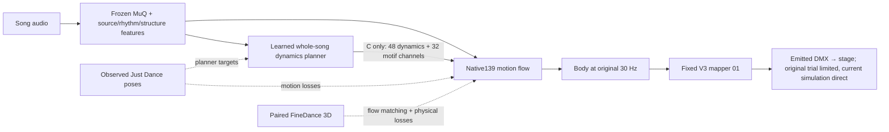

# Native dynamics learned from dance recordings

This experiment replaces post-generation speed correction with motion-data supervision inside an audio-conditioned native flow. It does not promote a product baseline.

The paired experiment has three arms, each trained for 30,000 updates with seeds 0 and 1. All arms begin with the same seed-matched D7 checkpoint and see the same sampled recordings, windows, noise and source dropout. The displayed models use seed 0, irrespective of their scores.

| Arm | Motion learning | Planner connection |
|---|---|---|
| A — continued training | Paired FineDance flow matching and 3D physical losses; weak Just Dance reprojection and a frozen D7 field prior | Observer trained on the same motion labels, disconnected from generation |
| B — dynamics losses | A plus regional speed profiles, speed/acceleration distributions, low-motion duration and pose recurrence losses | Same disconnected observer |
| C — joint planner | B plus an audio-conditioned whole-song dynamics planner | 80 continuous channels enter bounded adapters in all eight flow blocks |

The planner runs at 2 Hz. Four temporal convolution blocks and whole-song attention predict 48 dynamics values and a 32-dimensional continuous motif representation. The dynamics values cover six regions: lower body, torso, head, left arm, right arm, and whole articulation. Each region has three ordered log-speed quantiles, a low-motion fraction, and four duration probabilities. Motion observations supervise these quantities; no verse/chorus rule, loudness-to-speed formula, or codebook supplies the targets.

D7 already had a velocity loss on paired native motion. The new intervention supervises the dynamics of generated trajectories using Just Dance observations and, in C, connects a learned global dynamics representation to the generator. It is not merely a renamed velocity loss.

The generator emits a native139 sequence at the original 30 Hz. Its 32 integration steps describe generative flow time, not the song's playback rate. There is no retiming, minimum playback-rate clamp, fragment copying or separate procedural movement source.

Solid arrows are generation-time inputs. Dotted arrows are training supervision; recorded dance poses are not supplied during inference. Arms A and B retain a trained observer planner but disconnect its output from the flow.

## What Just Dance supervises

The local Just Dance cache contains monocular 2D keypoints, not reliable native139 or metric 3D motion. The pilot uses 72 training song groups (4.74 hours) and 24 development groups (1.50 hours), after confidence, visibility, duration and duplicate checks. Missing observations remain masked; confident held poses remain valid observations.

Just Dance gradients act on actual current-model generated trajectories. Training executes the same 32-step forward solver as evaluation and differentiates through the final four steps. This is a truncated gradient estimate, not a shortened generation solver. Generated poses are projected into fixed torso-relative image coordinates for weak supervision. A fixed reflection per crop handles view ambiguity; there is no fitted per-frame camera or time alignment.

FineDance supplies genuine paired 3D flow-matching targets, root motion, support and geometry constraints. No unrelated 3D dance is paired with a Just Dance soundtrack. Just Dance speed measurements are expressed in projected torso-lengths per second, not metres per second. The weak 2D supervision cannot by itself establish correct depth or contact.

The first six pretrained flow blocks remain frozen. Late blocks, audio adapters, and the planner are trained; arm C also trains the new native control adapters. MuQ remains frozen.

## What carries over from D4, D6, D7 and D8

D7 supplies the initial audio-conditioned native flow. D6's useful idea—regional effort and duration—becomes observed-motion supervision rather than a playback clock. D8's global/local hierarchy becomes a jointly trained planner-to-generator connection. D4's recurrence objective becomes continuous pose-similarity supervision; it no longer copies or reorders saved fragments. This is a new trained architecture, not a claim that four independently trained systems can simply be merged.

## Audio inputs and light output

The frozen audio path combines MuQ, HTDemucs source observations, Beat This timing, All-In-One structure and the existing Base92 features. The [audio-study conclusions](/mnt/lightsem-data/experiments/lightsem/audio_understanding_20261004/reports/final_v1/CONCLUSIONS.md) support MuQ's practical temporal/context utility. That study also tested COCOLA, MAE, JEPA, matched MAE continuations, Fourier and MERT; this native-dynamics trial reuses frozen MuQ rather than starting another encoder-training campaign. It does not establish semantic choreography or dependable instrument absence. Its failed ridge activity threshold is not used.

The decoded body is explicitly resampled from 30 Hz onto the 40 Hz lighting clock using root/bone geometry. The fixed V3 mapper `01` converts assigned body bone directions into fixture targets. The original trial constrained pan/tilt speed and acceleration. At the user’s request on October 6, the new simulation path uses `TransferConfig.apply_motion_limits=False`: it bypasses temporal angle fitting and the 90°/s / 360°/s² hardware bounds. The renderer still reads actual emitted universes; only 16-bit representable angle ranges remain. Native body generation itself had no hard speed cap. Demos use 8 moving beams, 5 simulated laser beams and 50 bulbs. Frozen-body, individual-limb and 1/63/117-output checks remain required.

P2 controls color. The restored historical LUFS envelope controls global brightness, with the established body modulation. Neither changing color nor brightness is counted as movement improvement.

## Evaluation limits fixed before candidate scoring

The frozen development set has 108 windows: 72 Just Dance windows and 36 FineDance recordings. Observational QA found that 38 of the 72 Just Dance windows lack measurements for at least one region/scale cell. They remain in the analysis; no windows, masks or confidence thresholds were changed. Available-cell errors are descriptive, while the full registered primary remains unqualified where coverage is incomplete.

Validation, physical checks, conditioning interventions and emitted-light checks are separate. Both corpora and both showcase songs are historically exposed; this experiment makes no unseen-test claim. No MUSDB TEST tuning is permitted.

## October 6 composition follow-up

The `hybrid_positive_v1` follow-up composes the saved native C body through historical D4-max and frozen D6 positive anchored pacing. D8’s hierarchy is already inside native C; the old D8 generation residual is not applied again. MuQ is used both by native generation/planning and by D4-max’s audio descriptor (0.7 MuQ / 0.3 source features). This follow-up changes the generated trajectory after inference; it does not retrain the model or prove that internal representations were repaired. The old positive-pacing C4 and native C are distinct models despite the reused historical alias.

The learned dynamics loss matches observed, timestamp-preserving regional speed profiles at 0.2/1/4 seconds, speed/acceleration distributions, low-motion occupancy/duration and pose recurrence. It does not reward arbitrary variability or slowing down indiscriminately. Just Dance targets are masked 2D torso-normalized motion observations; FineDance provides paired 3D supervision. The hybrid additionally imposes the historical D6 clock interval 0.25–1.5× within unchanged motif anchors, which is a composition rule rather than a real-fixture speed limit.

## Verified training repair — October 6

The old smoothed 2D dynamics loss remains an observation measurement, not a certificate of raw 3D quality. The repair adds training losses on raw generated world positions: fast residual energy, third temporal differences, root height, support velocity and floor penetration. FineDance supplies its real paired 3D reference. On Just Dance, a frozen D7 rollout with identical audio/noise supplies a stability prior; it is never called Just Dance 3D ground truth. No output filter, retiming, motion recomposition or fixture speed cap is used.

The two 30,000-update repaired runs exactly matched the original C initialization, data draws and exposure. They improved jerk/root/development metrics but failed one unchanged fast-residual gate. Matched 3,000-update HF1/HF4 continuations were preserved as failures where gates failed. A second matched 2,500-update HF4/HF16 continuation selected HF16 only after all original gates passed on both seeds, both complete songs, the fixed90–150s interval and development groups. Display remains seed0; no checkpoint or seed was picked for a flattering video. Total native updates for the selected weights:35,500.

Selection evidence: `/mnt/lightsem-data/experiments/lightsem/native_dynamics_jd_20261005_v1/repair_refine_v2/reports/SELECTION.json`. The single review page uses `/mnt/lightsem-data/experiments/lightsem/native_dynamics_jd_20261005_v1/repair_review_v1`. Engineering stability is verified; musical/artistic acceptance remains human review, and P2 is still only the accepted color baseline.

## Working motion reference and next recipe — October 6

The user subsequently requested a new baseline definition. The verified HF16
native C checkpoint at seed0 is now the working motion comparison reference in
`configs/dance/baseline.json`. Its weights and existing media are unchanged.
P2 remains the color baseline; historical brightness and the experimental01
mapper are fixed, with fixture speed/acceleration limits off in simulation.
The reference has no external D4 composition, D6 clock, or extra D7/D8 model.
Its integrated dynamics, hierarchy and recurrence borrow principles from those
approaches; this does not make it a reproduction of the separate algorithms.

This checkpoint was trained on the bounded72-song JD cohort and still includes
the original clipped quiet-motion loss. The stable BCEWithLogits correction is
code-tested, but has not been retrained into these weights. The next recipe in
`configs/dance/native_speed_next.json` calls for all eligible TRAIN material,
fixed development/quarantines, observed slow/medium/fast sampling and native
regional speed/duration learning. It is defined, not trained or qualified.

The user separately requested fixed C+D4-max+D6 previews for human review.
They are post-generation recomposition/positive anchored retiming of the
own-song repaired-C bodies, not a new learned generator or a baseline change.
Their source/generation/physical/media evidence is kept under
`native_dynamics_jd_20261005_v1/fixed_c_hybrid_check_20261006_v1`.

## Selected CLI baseline and campaign closure — October 6

The subsequent user instruction promotes fixed C to the default motion path.
`configs/dance/fixed_c.json` is active; the prior reference configuration stays
immutable. `lightsem.cli dance` generates its body and `lightsem.cli render`
generates actual DMX and a lit3D movie. Frozen MuQ is required for every run.
`--d4max` and `--d6` independently enable post-generation modifiers; both
default off, and D6 also operates on native C without D4. The trained D6 clock
uses its original0/.5/1s export grid, distinct from C's planner frame centers.
The former rule-driven renderer is named `legacy-render` for old studies.

CLI validation on both songs reproduces plain C bodies/native channels and
emitted universes exactly. All four modifier combinations were exercised with
the real checkpoints and MuQ caches; the combined output differs from the
reviewed previews by at most4.1micrometres due to CPU/GPU planner arithmetic.
Two actual one-second CLI renders decode completely.918regression tests and
23subtests pass; targeted range-server checks also pass. The cold P2 path was
checked with a real8second waveform and pinned weights on CPU. These are
integration checks, not fresh musical superiority evidence.

The user closed the completed research campaigns. All97registered runs across
the audio, transfer and dance campaigns were already closed; their computed
verdicts remain unchanged. The four remaining campaign problems are parked,
with interpretation debt cleared. The quiet-gradient correction is code-only,
and broader-data training remains an unexecuted next recipe. Original failed
branches, checkpoints, protocols, videos and hashes are retained outside Git.
See `CAMPAIGN_CLOSURE.json` and `CLI_VALIDATION.json` in this directory.
